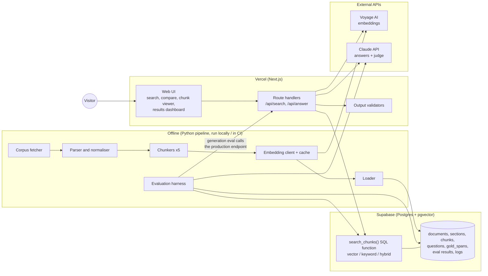
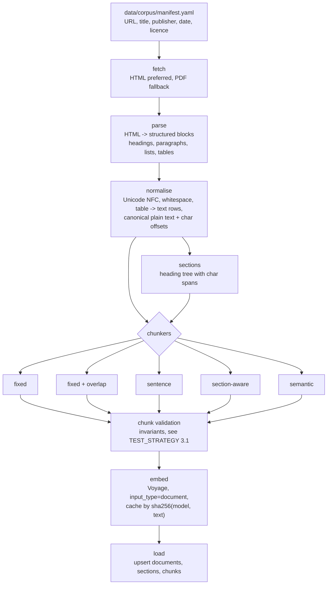
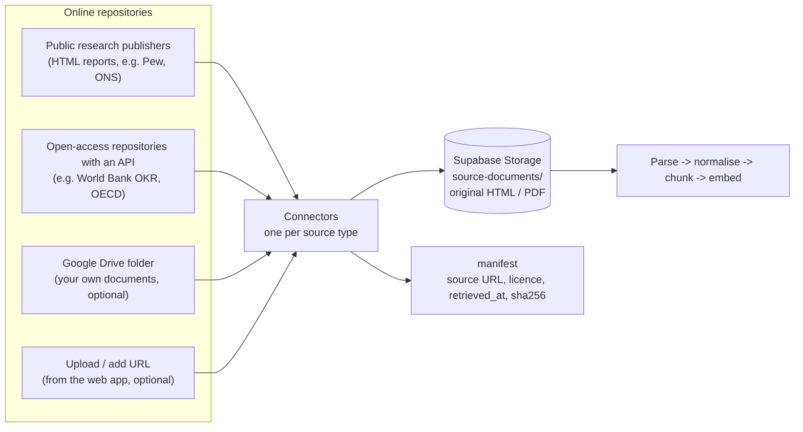
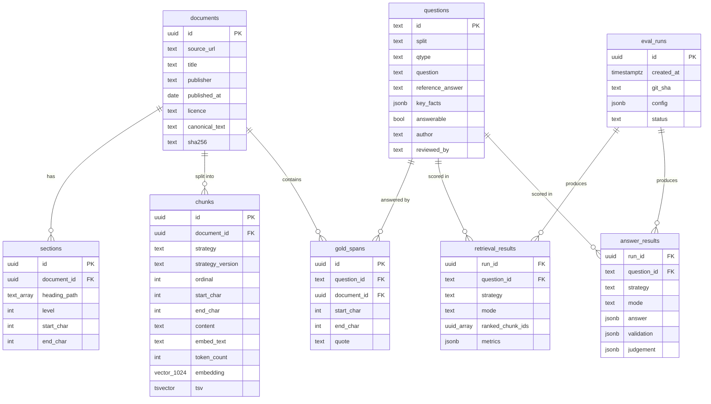
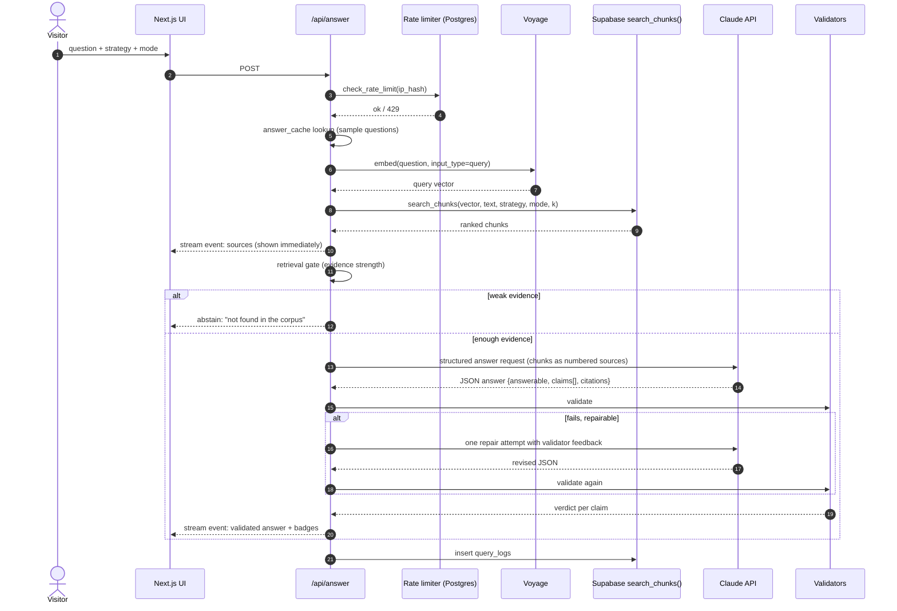
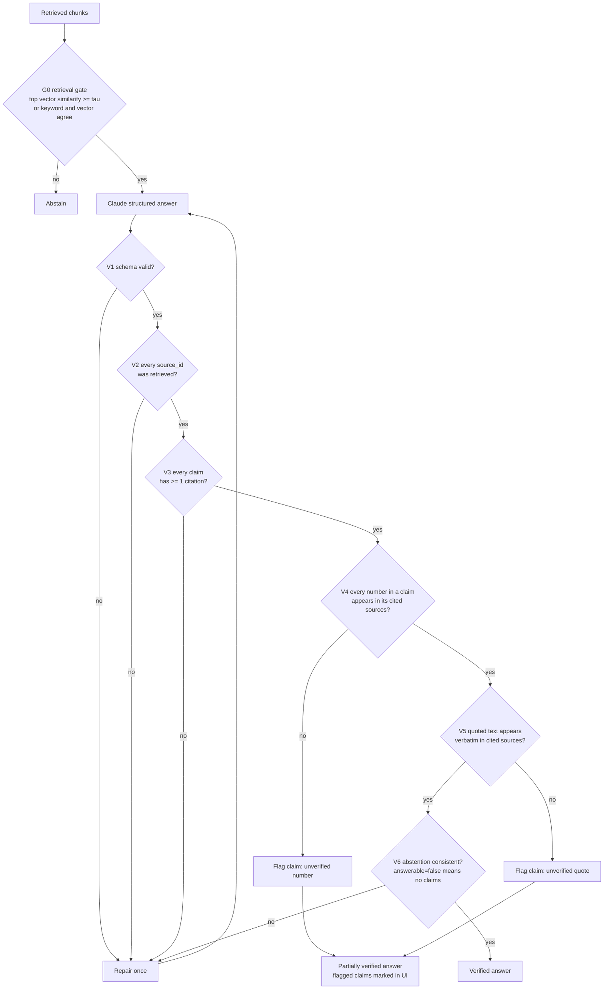
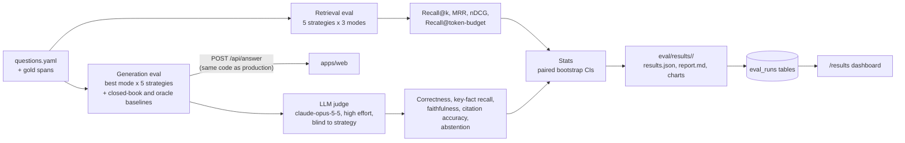
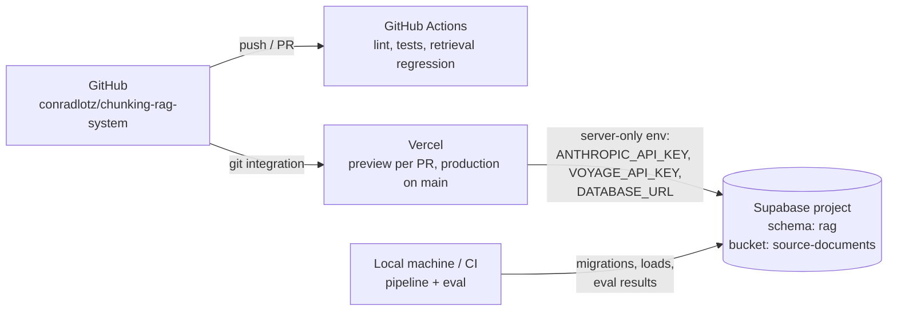

# Architecture

Chunking Lab is a retrieval-augmented question-answering system over a corpus of
public research reports, built to **measure** how chunking strategy affects
retrieval quality and answer accuracy, and to **validate** every answer it
shows against its sources.

This document covers the system design. The evaluation methodology and test
plan live in [TEST_STRATEGY.md](TEST_STRATEGY.md); scope and milestones in
[PLAN.md](PLAN.md).

---

## 1. Design goals

| # | Goal | What it means in practice |
|---|------|---------------------------|
| G1 | **Fair comparison** | Every chunking strategy shares the same corpus, embedding model, tokenizer, retrieval code, prompt and answer model. Only the chunk boundaries change. |
| G2 | **Measure what ships** | The evaluation harness calls the same SQL search function and the same answer endpoint that the live site uses. No parallel "eval-only" code path. |
| G3 | **Validated output** | No answer reaches the user without deterministic checks: schema, citation validity, numeric and quote grounding, abstention. |
| G4 | **Explainable** | Every answer links to the exact passages used; the UI shows how each strategy split each document. |
| G5 | **Cheap and safe to host publicly** | Rate limits, a daily spend cap, cached answers for sample questions, no secrets in the browser. |

---

## 2. System context



**Split of responsibilities**

| Component | Language | Owns |
|-----------|----------|------|
| `pipeline/` | Python 3.12 (uv) | Fetching, parsing, chunking, embedding, loading, retrieval metrics, LLM judge, statistics, reports |
| `apps/web/` | TypeScript, Next.js (App Router), Tailwind, shadcn/ui | UI, query embedding, search, answer generation, output validation, rate limiting |
| `supabase/` | SQL migrations | Schema, indexes, `search_chunks()` SQL function, integrity triggers, row-level security, rate-limit function |
| `packages/contracts/` | JSON Schema | The answer contract shared by the TypeScript validators and the Python eval harness |

Why two languages: the data/eval tooling for NLP is strongest in Python; the
runtime is a web app and belongs with the UI. The answer path and its
validators live **only** in TypeScript, and the eval harness calls that path
over HTTP, so there is one implementation to trust (G2).

---

## 3. Offline ingestion pipeline



### 3.0 Document sources and the document store

Documents come from **online repositories of published research**, not from
hand-made samples. The pipeline has one small connector per source; each
connector writes the original file to a **Supabase Storage bucket**
(`source-documents`, private) before parsing:



Why snapshot the originals: web pages change. Gold-span offsets point into the
text as it was when the questions were written, so the pipeline must always be
able to rebuild from the exact same bytes. The `sha256` in the manifest proves it.

Which repositories and which topic make up the corpus is an open decision
(see PLAN.md, section 6). Every source must allow reuse with attribution, and its
licence is stored on each document and shown in the UI.

### 3.1 Canonical text and character offsets

Every document is normalised once into a single **canonical plain text**.
Everything downstream refers to it by character offset:

- each chunk stores `start_char` / `end_char` into the canonical text;
- each gold answer passage (see TEST_STRATEGY) is a `start_char` / `end_char` span
  in the same text.

This is what makes the comparison fair: relevance is computed by span overlap,
independent of how any strategy happened to cut the document.

### 3.2 Chunking strategies

All sizes are measured with **one tokenizer** (the embedding model's own
tokenizer) for every strategy.

| Strategy | Key | How it splits | Default parameters |
|----------|-----|---------------|--------------------|
| Fixed-size | `fixed` | Consecutive windows of N tokens, ignores structure | 512 tokens |
| Fixed + overlap | `fixed_overlap` | Same windows, each overlapping the previous one | 512 tokens, 128 overlap (25%) |
| Sentence | `sentence` | Sentence split (spaCy/pySBD), sentences packed greedily up to the budget; never splits a sentence | ≤ 512 tokens |
| Section-aware | `section` | One chunk per section of the heading tree; long sections split on paragraph boundaries, tiny sections merged with their neighbour | 128–1024 tokens |
| Semantic | `semantic` | Embed consecutive sentences, start a new chunk where similarity to the previous sentence drops below the 90th-percentile breakpoint | 128–1024 tokens |

Controlled factors (held constant in the primary experiment, varied in
secondary experiments):

- **Embed text prefix** - every chunk is embedded as `"{doc title}\n\n{chunk text}"`.
  A secondary experiment adds the heading path (`Title > H2 > H3`) to all strategies.
- **Fixed size sweep** - secondary experiment on the dev set: 256 / 512 / 1024.

Chunkers share one interface so new strategies drop in without touching the rest:

```python
class Chunker(Protocol):
    key: str              # "fixed", "section", ...
    version: str          # bumped when behaviour changes; stored on every chunk
    def chunk(self, doc: CanonicalDocument) -> list[Chunk]: ...

@dataclass(frozen=True)
class Chunk:
    document_id: str
    strategy: str
    ordinal: int
    start_char: int
    end_char: int
    text: str             # == doc.text[start_char:end_char]
    heading_path: tuple[str, ...]
    token_count: int
```

### 3.3 Embeddings

- Provider: **Voyage AI** (`voyage-3.5`, 1024 dimensions) with `input_type="document"`
  for chunks and `input_type="query"` for questions. *Pending final confirmation, see PLAN.md.*
- The provider sits behind an `Embedder` interface, so swapping to another model
  is a config change plus a re-embed.
- **Embedding cache**: keyed by `sha256(model, input_type, text)` in a local SQLite
  file. Re-running the pipeline or the eval re-embeds nothing that hasn't changed.
  This makes runs cheap and repeatable.

---

## 4. Data model



Two operational tables sit outside the diagram: `query_logs` (query, strategy,
mode, latency, retrieved IDs, validation outcome, hashed IP; no personal data)
and `answer_cache` (pre-computed answers for the sample questions).

The schema is in
[`supabase/migrations/20261010000000_rag_schema.sql`](../supabase/migrations/20261010000000_rag_schema.sql)
and also includes `strategies` (the strategy registry the UI reads), and
database-enforced integrity:

- a trigger rejects any gold span whose `quote` doesn't match the document text at its offsets;
- a trigger freezes `canonical_text` once chunks or gold spans point into it;
- `rag.verify_chunks()` returns every chunk whose content doesn't match its span
  (the loader requires it to return zero rows).

### 4.1 Indexing decisions

- `chunks(strategy, document_id)` B-tree, GIN on `tsv`.
- **No approximate-nearest-neighbour index** at this scale (roughly 3k chunks per
  strategy). Exact cosine search over one strategy takes milliseconds, and it
  removes ANN recall error as a confounding variable in the comparison (ADR-2).
  If the corpus grows, add per-strategy partial HNSW indexes.

---

## 5. Retrieval

One SQL function serves both the live site and the evaluation harness:

```sql
search_chunks(
  query_embedding vector(1024),
  query_text      text,
  p_strategy      text,
  p_mode          text,   -- 'vector' | 'keyword' | 'hybrid'
  p_k             int     -- default 10
) returns table (chunk_id uuid, score float, vector_rank int, keyword_rank int)
```

| Mode | How it ranks |
|------|--------------|
| `vector` | Cosine distance (`<=>`) on `embedding`, exact scan within the strategy |
| `keyword` | `websearch_to_tsquery('english', query_text)` ranked with `ts_rank_cd` |
| `hybrid` | Reciprocal Rank Fusion of the top 50 from each: `score = Σ 1 / (60 + rank)` |

This is the same idea as an OpenSearch hybrid query (BM25 + k-NN with score
normalisation), implemented inside Postgres.

Optional stage (stretch): a reranker (`voyage rerank-2.5`) over the top 30
hybrid candidates, evaluated as its own retrieval mode.

---

## 6. Answer path (runtime)



### 6.1 Generation

- Model: `claude-opus-5-5`, effort `low` for the live path (latency), configurable.
  Server-side refusal fallback (`fallbacks: "default"`) enabled.
- **Structured output** (`output_config.format` with a JSON schema) instead of free text:

```json
{
  "answerable": true,
  "answer": "Short direct answer in plain prose.",
  "claims": [
    { "text": "64% of adults said ...", "source_ids": ["S3"] }
  ],
  "abstain_reason": null
}
```

- Retrieved chunks are passed as numbered sources `S1..Sk`; the model may only
  cite those IDs. Retrieved text is wrapped as data, and the system prompt says
  instructions inside sources are ignored (basic prompt-injection hygiene).
- The prompt tells the model to abstain when the sources do not contain the
  answer, rather than relying on its own background knowledge.

### 6.2 Validate, then display

The answer is **not** streamed token-by-token. Sources stream first (fast and
useful), then the answer appears only after validation. Showing unvalidated text
and retracting it later would defeat the point (ADR-4).



| Check | Type | Catches |
|-------|------|---------|
| G0 retrieval gate | Threshold, tuned on the dev set | Questions the corpus can't answer |
| V1 schema | JSON Schema (`packages/contracts/answer.schema.json`, zod at runtime) | Malformed output |
| V2 citation existence | Set membership | Invented source IDs |
| V3 citation coverage | Rule | Unsupported claims |
| V4 numeric grounding | Normalised number match (`45%` = `45 percent` = `0.45`; commas; spelled-out numbers) | Wrong or hallucinated figures, the most damaging error for research data |
| V5 quote grounding | Whitespace/quote-normalised substring | Fabricated quotations |
| V6 abstention consistency | Rule | Contradictory output |

Validators are deterministic, fast and free. A model-based faithfulness check
is used **offline** in evaluation, where cost and latency don't matter
(see TEST_STRATEGY 6).

Each response carries a `validation` object (per-claim status plus overall
`verified` / `partially_verified` / `abstained`), which the UI renders as badges
and which is logged for analysis.

---

## 7. Evaluation harness (overview)



Full methodology: [TEST_STRATEGY.md](TEST_STRATEGY.md).

---

## 8. Web application

| Route | Purpose |
|-------|---------|
| `/` | Search: question box, strategy/mode selector, validated answer with citation chips; clicking a chip highlights the passage in its document |
| `/compare` | The same question answered by two strategies side by side, with retrieved chunks and their ranks |
| `/chunks/[docId]` | Chunk viewer: one document, each strategy's boundaries drawn as coloured bands, gold spans overlaid |
| `/results` | Evaluation dashboard: metric charts by strategy and question type, confidence intervals, per-question drill-down |
| `/about` | Method, corpus and attribution, limitations |

| API route | Method | Notes |
|-----------|--------|-------|
| `/api/search` | POST | Retrieval only, used by `/compare` and the chunk viewer |
| `/api/answer` | POST | Full answer path; Server-Sent Events: `sources` then `answer` |
| `/api/documents/[id]` | GET | Canonical text, sections and chunks for the viewer |

UI stack: Next.js App Router, Tailwind, shadcn/ui, Recharts for the dashboard.
Light and dark themes; responsive down to phone width.

Further feature modules (claim checker, stat finder, theme map, research brief,
retrieval trace, live ingestion) are proposed in [PLAN.md](PLAN.md) section 4.
Each one reuses `search_chunks()` and the validators above; none adds a
second retrieval or validation path.

---

## 9. Deployment and security



- **Secrets**: API keys exist only in server-side environment variables
  (Vercel, local `.env`, GitHub Actions secrets). The browser never receives a key.
- **Shared Supabase project, isolated schema**: the Supabase project also hosts
  an unrelated app, so everything here lives in its own `rag` schema. Nothing in
  `public` is read or changed.
- **Server-only database access**: the `rag` schema is **not** exposed through
  the Supabase Data API. The pipeline and the Next.js route handlers connect with
  a Postgres connection string (Supavisor pooler, transaction mode) held in
  `DATABASE_URL`. The browser never talks to the database.
- **RLS as defence in depth**: enabled on every `rag` table with no policies,
  and `anon` / `authenticated` have no grants on the schema or its functions.
  If the schema were ever exposed by mistake, those roles would still see nothing.
- **Abuse and cost controls**: per-IP rate limit (for example 20 answers per hour,
  in a Postgres table keyed by a salted IP hash), a global daily cap on answer
  calls, max question length, sample questions served from `answer_cache`.
- **Cost estimate (live path)**: about 3k input + 400 output tokens per answer
  on `claude-opus-5-5` at $4 / $20 per million tokens is about $0.02 per answer,
  so a daily cap of 500 answers bounds spend at about $10 per day.
- **Observability**: `query_logs` table plus Vercel logs; the dashboard can show
  live validation pass rates.

---

## 10. Non-functional targets

| Metric | Target |
|--------|--------|
| Retrieval latency (server, p50) | < 300 ms |
| First sources visible (p50) | < 1 s |
| Validated answer (p50) | < 6 s |
| Full pipeline re-run (cached embeddings) | < 5 min |
| Full generation eval cost | < $15 per run |

---

## 11. Repository layout

```
.
├── apps/web/                 Next.js app (UI, API routes, validators)
├── packages/contracts/       answer.schema.json and shared types
├── pipeline/                 Python package (uv)
│   ├── chunking_lab/
│   │   ├── ingest/           fetch, parse, normalise
│   │   ├── chunkers/         base, fixed, overlap, sentence, section, semantic
│   │   ├── embed/            embedder interface, Voyage client, cache
│   │   ├── store/            Supabase loader
│   │   └── eval/             metrics, spans, judge, runner, stats, report
│   └── tests/                unit, property, integration
├── supabase/migrations/      schema, SQL functions, triggers, RLS
├── data/
│   ├── corpus/manifest.yaml  source list with licence and attribution
│   └── questions/            questions.yaml (dev + test) with gold spans
├── eval/results/             versioned run outputs
└── docs/                     PLAN, ARCHITECTURE, TEST_STRATEGY, RESULTS
```

---

## 12. Architecture decision records

| ADR | Decision | Why | Trade-off |
|-----|----------|-----|-----------|
| 1 | Postgres + pgvector on Supabase, not OpenSearch | Hosted free tier, one store for vectors, keyword search, eval results and logs; hybrid search via `tsvector` + RRF | Loses OpenSearch-specific features (analyzers, native hybrid pipelines); concepts carry over directly |
| 2 | Exact k-NN, no ANN index | ~3k vectors per strategy; removes ANN recall error from the comparison | Must add HNSW if the corpus grows by orders of magnitude |
| 3 | Gold labels are character spans in canonical text | Strategy-agnostic relevance; the same labels score every strategy | Requires careful span annotation and a canonical text that never changes after labelling |
| 4 | Validate, then display; no token streaming of answers | Never show text that may be retracted; sources stream first to hide latency | Answer appears all at once, a few seconds later |
| 5 | Eval calls the production answer endpoint | One implementation of prompt + validators; results describe what ships | Eval needs the web app running (locally or a preview deployment) |
| 6 | Voyage embeddings behind an interface | Strong retrieval quality, recommended pairing with Claude, free tier covers the project | Third vendor and key; mitigated by the interface plus cache |
| 7 | HTML sources preferred over PDF | Heading structure is explicit in HTML, which section-aware chunking needs | Some reports are PDF-only; PDF path uses PyMuPDF with font-size heading detection |
| 8 | Deterministic validators at runtime, LLM judge offline | Free, fast, explainable at runtime; deeper but costlier checks where latency doesn't matter | Runtime can't catch a subtly wrong paraphrase whose numbers are right; measured offline |
