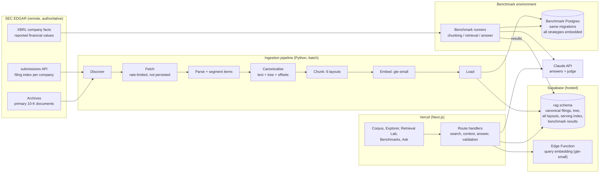
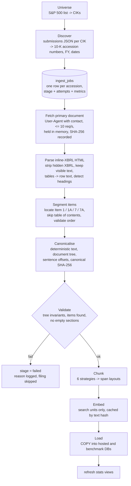
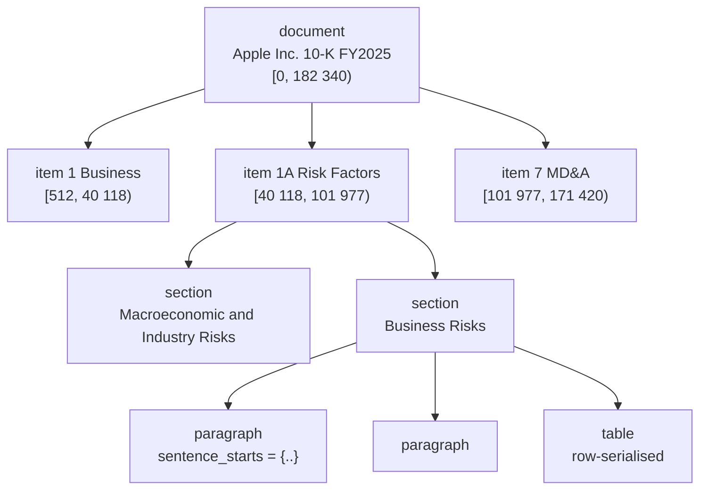
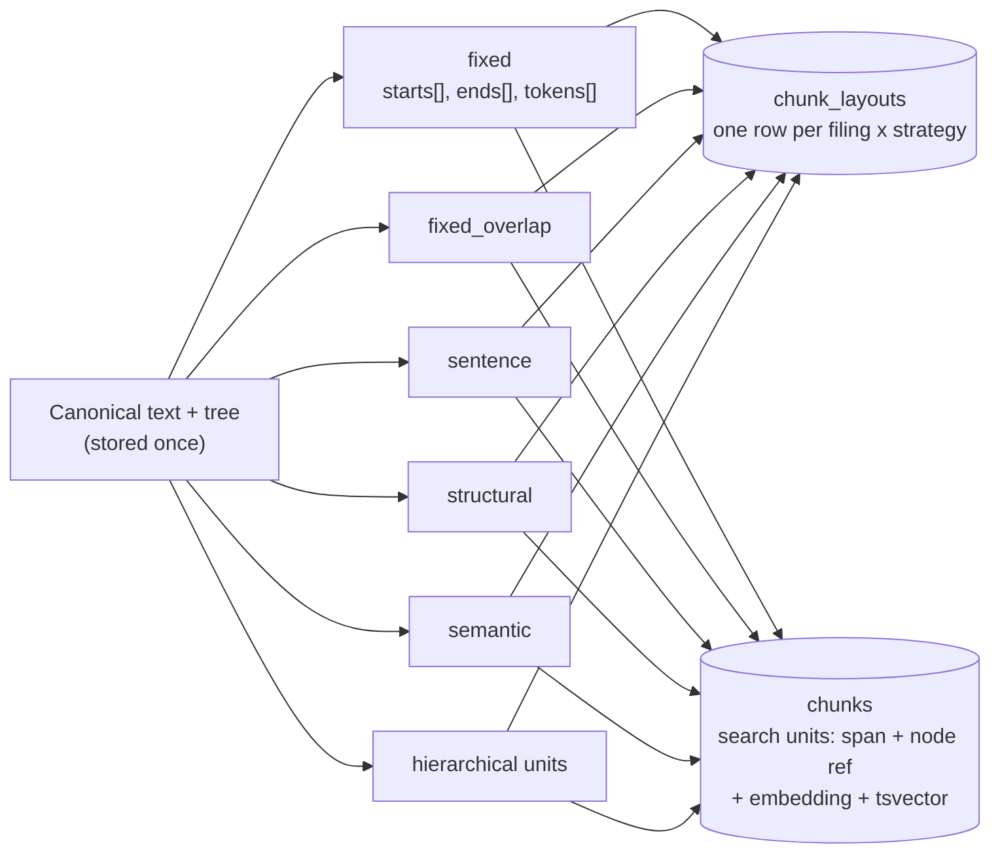
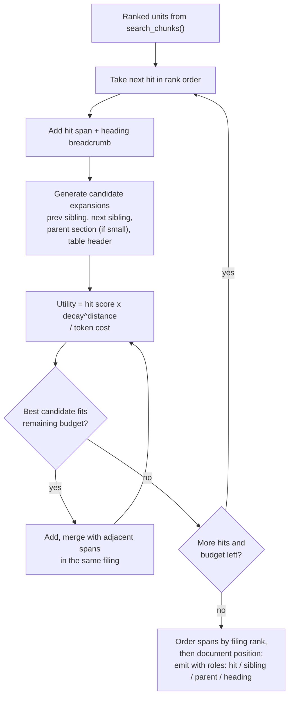
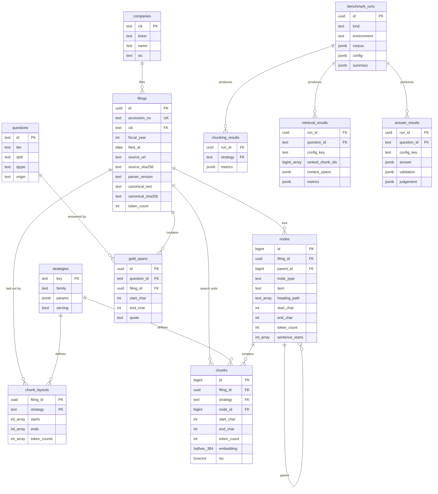
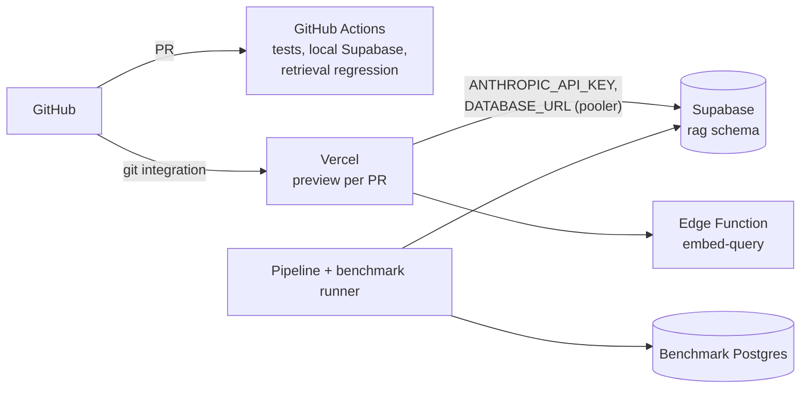

# Architecture

Chunking Lab is an experimental platform for measuring how **document
structure, chunking strategy, retrieval mode and context construction** affect
retrieval quality and answer accuracy, run over **1,000+ SEC 10-K filings**.
The source filings stay at the SEC; the platform owns a canonical, hierarchical
representation of each filing with stable character offsets, and everything
else (chunks, embeddings, indexes, benchmarks) is defined against it.

Related: [TEST_STRATEGY.md](TEST_STRATEGY.md) (benchmarks and tests),
[PLAN.md](PLAN.md) (scope, milestones, decisions).

---

## 1. Design principles

| # | Principle | Consequence |
|---|-----------|-------------|
| P1 | **Sources stay remote** | Filings are fetched from sec.gov by accession number and never re-hosted. Only the derived canonical text and metadata are stored, each linked back to its source URL with the source file's SHA-256. |
| P2 | **One canonical representation** | Every filing is parsed once into a document tree with stable character offsets. Chunking strategies, gold answer spans, search units and context windows are all **spans over that representation**, not copies of text. |
| P3 | **Strategies are layouts, not copies** | A chunking strategy produces an ordered list of `(start, end)` offsets per filing. Storing a strategy costs a few integer arrays per filing; text is always sliced from the canonical text. |
| P4 | **Separate the questions** | The *chunking benchmark* measures the chunks themselves (no retrieval). The *retrieval benchmark* measures what reaches the model's context. The *answer benchmark* measures the answers. Each has its own metrics and runs. |
| P5 | **Context construction is a variable** | Retrieval returns ranked units; a separate, versioned **context constructor** turns them into the model's context under a token budget. Static concatenation is one policy; hierarchical/dynamic expansion is another. |
| P6 | **Measure what ships** | The benchmark and the live site call the same SQL search and context functions. A parity test proves the hosted index ranks exactly like the benchmark index. |
| P7 | **Show the engineering** | The UI's primary job is to expose the corpus, the layouts, the retrieval trace and the metrics. The answer box is one panel among several. |

---

## 2. System overview



| Component | Technology | Responsibility |
|-----------|------------|----------------|
| `pipeline/` | Python 3.12 (uv) | SEC connector, parsing, canonicalisation, chunkers, embedding, loading, benchmark runners, statistics |
| `supabase/` | SQL migrations, one Edge Function | Schema, integrity triggers, `search_chunks()`, `build_context()`, stats views; query embedding function |
| `apps/web/` | Next.js App Router, TypeScript, Tailwind, shadcn/ui | UI, API routes, answer generation, output validators |
| `packages/contracts/` | JSON Schema | Answer schema and context-span schema shared by TypeScript and Python |

---

## 3. Corpus

| Property | Value |
|----------|-------|
| Source | SEC EDGAR, form **10-K** |
| Universe | S&P 500 constituents (pinned constituent list, dated), mapped to CIKs via SEC `company_tickers.json` |
| Years | Fiscal years 2024 and 2025, about **1,000 filings** minimum; the pipeline is size-agnostic |
| Sections | Item 1 (Business), 1A (Risk Factors), 7 (MD&A), 7A (Market Risk) |
| Excluded | Financial statements and exhibits. Reported figures come from the XBRL company-facts API, which is exact, instead of from parsed statement tables |
| Expected size | ~40k tokens per filing in scope, **~40M tokens** in total (measured at load and shown in the UI) |

The four items were chosen because they are long, heterogeneous narrative with
embedded tables, nested headings and cross-references: exactly where chunking
decisions matter.

---

## 4. Ingestion pipeline



- **Resumable and idempotent.** `ingest_jobs` keys each filing by accession number
  and records its last completed stage. Re-runs skip finished work; failures are
  retried with a cap and reported, never silently dropped.
- **Incremental.** New 10-Ks are discovered from the same submissions API, so a
  scheduled run can add filings as companies file them.
- **Throughput is measured, not assumed.** Each stage records documents per
  minute, tokens per second and errors; the Corpus page shows them.
- **SEC fair access.** A declared `User-Agent` with contact details and a shared
  token-bucket limiter at ≤ 10 requests per second across all workers.

---

## 5. Canonical hierarchical representation

### 5.1 Tree



Node types: `document`, `item`, `section` (nested headings), and leaf blocks
`paragraph`, `table`, `list`. Every node stores `start_char`, `end_char`, `depth`,
`ordinal` (pre-order), `heading_path` and `token_count`. Sentence boundaries are
stored as an offset array on each leaf block rather than as separate rows,
which keeps the table small while preserving sentence-level addressing.

### 5.2 Canonical text rules

The canonical text is a deterministic serialisation of the tree:

- Unicode NFC; whitespace collapsed within blocks; one blank line between blocks.
- Headings are emitted as their own lines so they belong to the text and can be
  cited and embedded.
- Tables are serialised row by row as `cell | cell | cell`, with the header row
  repeated in the table node's metadata.
- Characters outside the Basic Multilingual Plane are replaced, so offsets mean the
  same thing in Python (code points), Postgres (`substr`) and JavaScript (UTF-16).

### 5.3 Stable offsets

- A filing's canonical text is identified by `(accession_no, parser_version)` and
  verified by `canonical_sha256`.
- The database **refuses** to change the canonical text of a filing that chunks or
  gold spans point into (trigger), and **refuses** any gold span whose quote does
  not match the text at its offsets (trigger).
- A new parser version produces a new representation; gold spans are migrated by
  re-anchoring their quotes, and any span that can't be re-anchored exactly is
  flagged for review.
- The original document is always one click away: `source_url` points to sec.gov,
  and `source_sha256` proves which bytes the representation came from.

---

## 6. Chunking strategies as span layouts



| Key | Family | Boundaries | Parameters |
|-----|--------|-----------|------------|
| `fixed` | static | Token windows, structure-blind | 480 tokens |
| `fixed_overlap` | static | Token windows with overlap | 480 / 120 overlap |
| `sentence` | static | Whole sentences packed to the limit (uses `sentence_starts`) | ≤ 480 |
| `structural` | static | Follows items, sections and blocks: packs small sibling blocks, splits long blocks on sentences, never crosses a section | 64–480 |
| `semantic` | static | Sentence embeddings; new chunk where adjacent similarity falls below the 90th-percentile breakpoint | 64–480 |
| `hierarchical` | hierarchical | Small structure-aligned **units** (blocks, or sentence groups of long blocks) retrieved, then expanded through the tree at query time (section 8) | unit ≈ 256, max 480 |

- **480 tokens** everywhere: `gte-small` accepts 512 tokens including special
  tokens and the context prefix (`Company · FY · Item · heading`) that every unit
  is embedded with. All token counts use the `gte-small` tokenizer.
- A strategy is defined by its layout only. Each layout row holds
  `starts[]`, `ends[]`, `token_counts[]` for one filing, so all six layouts for
  1,000 filings fit in a few megabytes and are always available for the chunking
  benchmark and the boundary visualisation.
- Each search unit in `chunks` references the smallest tree node containing it
  (`node_id`), which is what lets the context constructor navigate from a hit to
  its parent section and siblings.

---

## 7. Embeddings

- Model: **`gte-small`** (384 dimensions), Supabase's built-in embedding model.
- **Corpus embeddings** are computed offline in the pipeline with the same model
  weights (`Supabase/gte-small`, ONNX), mean pooling and normalisation, batched by
  length, and cached by `sha256(model, text)`.
- **Query embeddings** at runtime come from a Supabase Edge Function using
  `Supabase.ai.Session('gte-small')`.
- A **parity test** embeds a fixed sample both ways and requires cosine similarity
  ≥ 0.999. Without it, a silent mismatch would degrade every result.
- Stored as `halfvec(384)` (768 bytes per unit).
- Volume: six strategies plus sentence embeddings for semantic chunking come to
  roughly 6–7 × the corpus tokens (~260M tokens). This is a one-off batch job,
  run on a GPU (or a many-core CPU overnight), and fully cached for re-runs.

---

## 8. Retrieval and context construction

### 8.1 Search

`rag.search_chunks()` serves both the live site and the benchmarks:

```
search_chunks(query_embedding halfvec(384), query_text, strategy, mode,
              k, tickers[], fiscal_years[], items[], exact, candidates, oversample, rrf_k)
  -> chunk_id, filing_id, node_id, start_char, end_char, token_count,
     score, vector_rank, keyword_rank, vector_similarity
```

| Mode | Ranking |
|------|---------|
| `keyword` | Postgres full-text, OR-semantics query, `ts_rank_cd` |
| `vector` | Cosine similarity |
| `hybrid` | Reciprocal Rank Fusion of both candidate lists (k = 60) |
| `hybrid_rerank` | Hybrid top 50 re-scored by a cross-encoder (benchmark-first; stretch for live) |

Vector search has two paths:

- `exact = true`: full scan. **Used by every benchmark**, so ANN error never
  contaminates strategy comparisons.
- `exact = false`: **binary-quantised HNSW** over `binary_quantize(embedding)`
  (48 bytes per unit) returns `candidates × oversample` units, which are re-ranked
  by exact cosine. Used live; its recall against the exact path is measured
  (TEST_STRATEGY section 7).

Filters (company, fiscal year, item) are applied inside the function, with
pgvector's iterative index scans so filtered queries still return `k` results.

### 8.2 Context construction

`rag.build_context(chunk_ids[], scores[], budget_tokens, policy)` returns an
ordered list of **context spans** `(filing_id, start, end, tokens, role, source_chunk_id)`.
It is the second half of retrieval and is benchmarked as such.

| Policy | Behaviour |
|--------|-----------|
| `static` | Hits in rank order until the budget is reached; overlapping spans merged and counted once |
| `parent` | Each hit replaced by its enclosing section when that fits the remaining budget, else by the hit alone |
| `window` | Each hit plus its previous and next sibling blocks |
| `dynamic` | Budgeted expansion through the tree (below) |



The constructor is implemented in SQL so the live site and the benchmarks run
the same code (P6), and its policy and parameters are recorded in every
benchmark result. Whether `dynamic` beats the best static layout at an equal
token budget is the project's primary research hypothesis (TEST_STRATEGY section 9).

---

## 9. Answer path


- Model `claude-opus-5-5` with structured output; server-side refusal fallback enabled.
- **Validated before display.** Sources stream first; the answer appears only after
  the deterministic validators run:

| Check | Catches |
|-------|---------|
| V1 schema | Malformed output |
| V2 citation existence | Source IDs that were not in the context |
| V3 citation coverage | Claims without a source |
| V4 numeric grounding | Numbers not present in the cited spans (normalised: `$1.2 billion`, `1,200 million`, `12%`, `12 percent`) |
| V5 quote grounding | Quotations not present verbatim |
| V6 abstention consistency | `answerable = false` with claims, or claims with no evidence |
| V7 XBRL cross-check | Financial figures that disagree with the company's reported XBRL value for that period (flagged, with the official value shown) |

---

## 10. Storage and environments

| Environment | Holds | Purpose |
|-------------|-------|---------|
| **Benchmark Postgres** (local Docker or CI runner, same migrations) | Everything: canonical filings, tree, all six layouts, **every strategy's search units embedded**, keyword indexes | Runs the retrieval and answer benchmarks over the full corpus with no storage ceiling |
| **Hosted Supabase** (free plan, isolated `rag` schema) | Canonical filings, tree, all six layouts, the **serving** strategy's embedded units, benchmark results, stats, logs | Powers the live UI: corpus views, boundary visualisation for every strategy, live retrieval on serving strategies, benchmark replays for the rest |

Which strategies are live is a flag (`strategies.serving`), not a design choice
baked into the schema. The default serving strategy is `hierarchical`. More can
be switched on as long as measured storage allows; the hosted size is shown on
the Corpus page.

Estimated hosted footprint for 1,000 filings (re-measured after the first 100
are loaded):

| Item | Estimate |
|------|----------|
| Canonical text (TOAST-compressed) | 60–70 MB |
| Document tree (nodes) | 40–50 MB |
| Six chunk layouts (integer arrays) | < 15 MB |
| Serving units: `halfvec(384)` + binary HNSW | 140–160 MB |
| Serving units: keyword `tsvector` + GIN | 90–110 MB |
| Benchmark results, logs | < 20 MB |
| **Total** | **~360–420 MB** of the 500 MB free plan (18 MB already used by another app) |

If the measurement after 100 filings projects past ~420 MB, the corpus is not
cut: the serving index moves to a dedicated Supabase project (a free organisation
can run two) or the project moves to the Pro plan. The architecture doesn't change.

---

## 11. Data model



Operational tables: `ingest_jobs`, `query_logs`, `answer_cache`, `rate_limits`.
Materialised views `corpus_stats` and `strategy_stats` feed the UI's counters and
are refreshed after each load.

---

## 12. User interface

The UI is a window onto the system, not a chat box. Every page answers "what is
the system doing and how well?"

| Page | Shows |
|------|-------|
| **Corpus** | Filings, companies, fiscal years, tokens, tree nodes, sentences; per-strategy chunk counts, token distributions and embedded units; ingestion throughput and failures; hosted storage used |
| **Explorer** | One filing: the item/section tree beside the canonical text; **chunk boundaries for any strategy drawn as bands**, two strategies overlaid for comparison; token count per chunk; gold spans highlighted; link to the original on sec.gov |
| **Retrieval Lab** | Run a query against a chosen strategy, mode, policy and budget: ranked units with vector rank, keyword rank and fused score; the **constructed context** as a budget bar (hit / sibling / parent / heading segments) and as highlighted passages in their filings; latency per stage |
| **Benchmarks** | Three tabs: **Chunking** (boundary alignment, fragmentation, size distributions per strategy), **Retrieval** (Hit@k, MRR, nDCG, Context Recall and Full-Evidence Rate vs token budget, with confidence intervals; per-question drill-down showing which gold characters each configuration recovered), **Answers** (correctness, faithfulness, abstention, validator catch rates, baselines) |
| **Ask** | Validated answer with claim-level badges and citations; the Retrieval Lab trace for that answer is one click away |
| **Method** | Corpus definition, strategies, metrics, hypotheses, limitations, SEC attribution |

Design: editorial and data-dense. A serif display face with a clean sans and a
monospaced face for figures; light and dark themes; one consistent chart palette;
⌘K command palette; responsive down to phone width. A clickable mock-up is
reviewed before the UI is built.

---

## 13. Deployment and security



- **Shared project, isolated schema.** The Supabase project also hosts another
  app; this one lives entirely in the `rag` schema and never reads or alters `public`.
- **Server-only access.** The `rag` schema is not exposed through the Data API;
  Next.js and the pipeline connect with a pooled Postgres connection string.
  RLS is enabled on every table with no policies, and `anon`/`authenticated` have
  no grants, so an accidental exposure would still return nothing.
- **Edge Function** accepts only text up to a fixed length and requires a server-held key.
- **Cost controls.** Per-IP and global daily limits on answer calls, cached answers
  for showcase questions, maximum question length.

---

## 14. Repository layout

```
.
├── apps/web/                    Next.js app
├── packages/contracts/          answer and context-span JSON schemas
├── pipeline/chunking_lab/
│   ├── sec/                     universe, discovery, fetch, rate limiter
│   ├── parse/                   inline-XBRL HTML, item segmentation, tables
│   ├── canonical/               serialiser, tree, sentence offsets, validation
│   ├── chunkers/                fixed, overlap, sentence, structural, semantic, hierarchical
│   ├── embed/                   gte-small ONNX, batching, cache
│   ├── load/                    COPY loaders, stats refresh
│   └── bench/                   chunking, retrieval, answer, ann_recall, parity, stats
├── pipeline/tests/
├── supabase/migrations/         schema, functions, triggers, RLS
├── supabase/functions/embed-query/
├── data/questions/              gold and silver question sets with spans
├── bench/results/               versioned benchmark outputs
└── docs/
```

---

## 15. Architecture decision records

| ADR | Decision | Why | Trade-off |
|-----|----------|-----|-----------|
| 1 | SEC EDGAR 10-Ks as the corpus | Real, public, immutable by accession number, deeply structured, with XBRL ground truth for figures | Domain is finance; narrative sections only |
| 2 | Canonical representation with frozen offsets | All strategies, labels and contexts are comparable spans over the same text | Parser changes require re-anchoring labels |
| 3 | Strategies stored as layouts; text never duplicated | Every strategy available for every filing at negligible cost | Text must be sliced at read time (cheap) |
| 4 | Separate benchmark database | Full-corpus, all-strategy retrieval benchmarks are not limited by the hosted plan | Two environments; kept identical by shared migrations and a parity test |
| 5 | Exact search in benchmarks, binary HNSW + exact re-rank live | Comparisons free of ANN error; live index ~16× smaller than full-precision HNSW | Live recall measured and reported |
| 6 | `gte-small` for all embeddings | Built into Supabase, no external vendor, identical model offline and online | 512-token limit, English only, weaker than large commercial models; constant across strategies, so comparisons stay fair |
| 7 | Context construction in SQL | One implementation for live and benchmark | More complex SQL; covered by dedicated tests |
| 8 | Validate before display | Never show text that may be retracted | Answer appears all at once |
| 9 | Postgres full-text + pgvector rather than OpenSearch | One store, free hosting, same hybrid concepts (BM25-style + k-NN + fusion) | `ts_rank_cd` is not BM25; noted in results |
