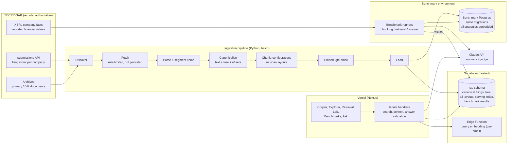
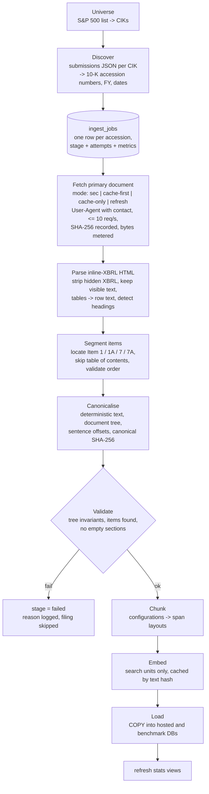
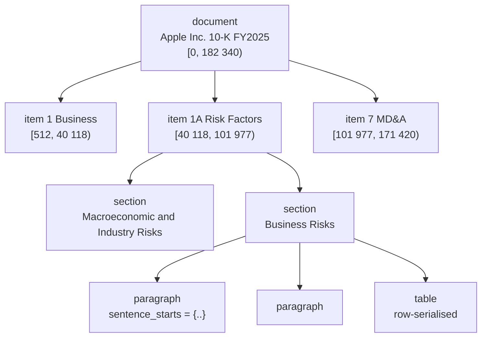
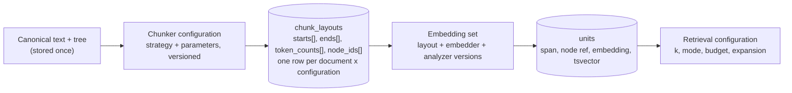
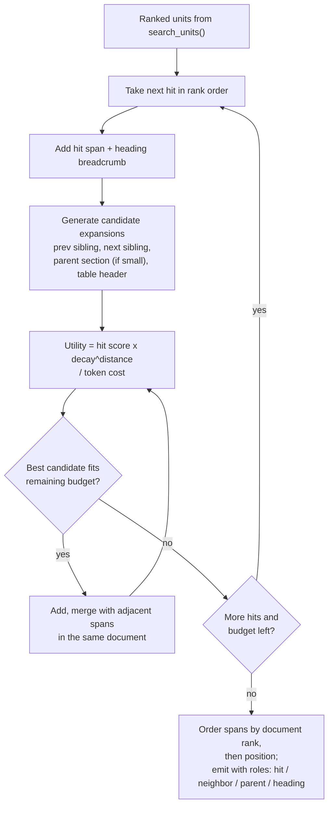
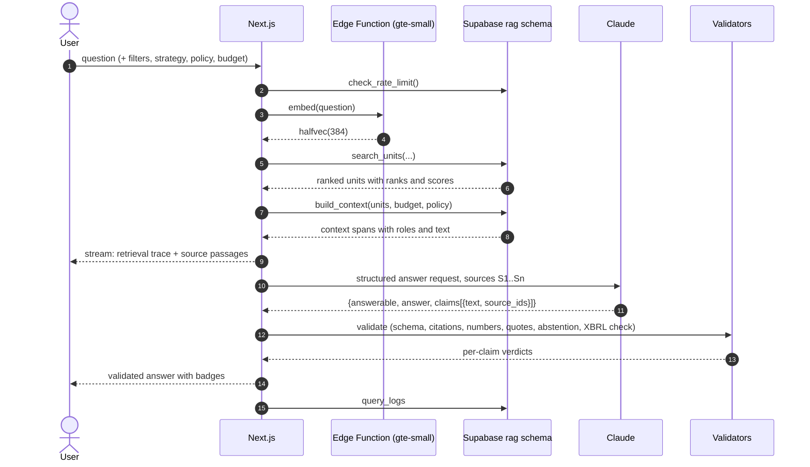
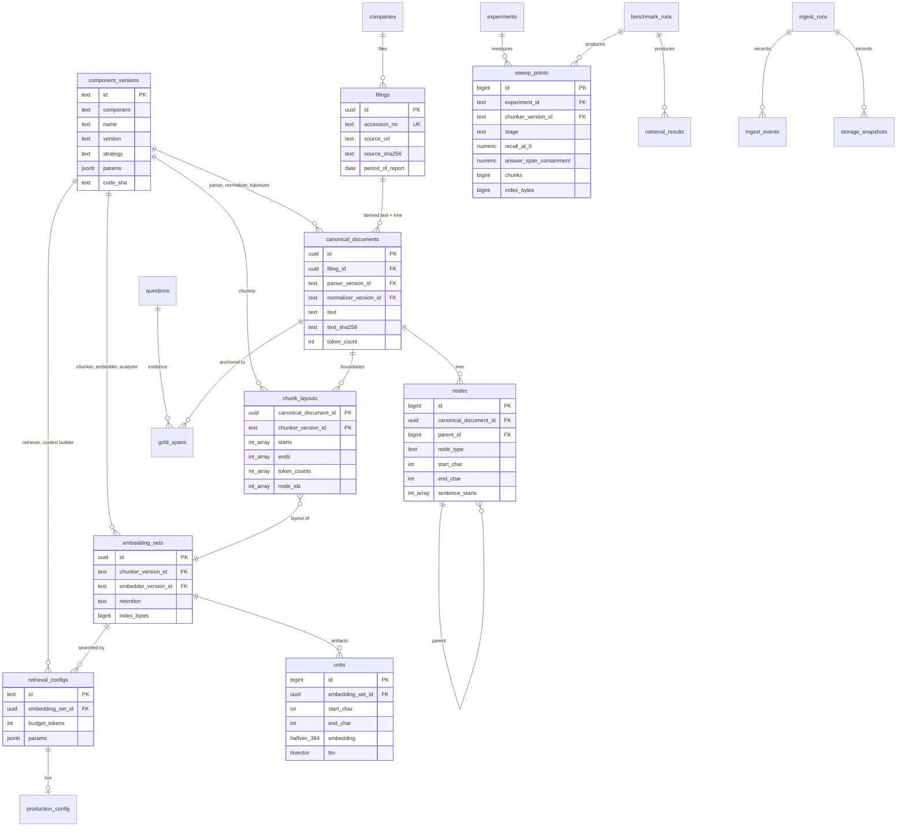
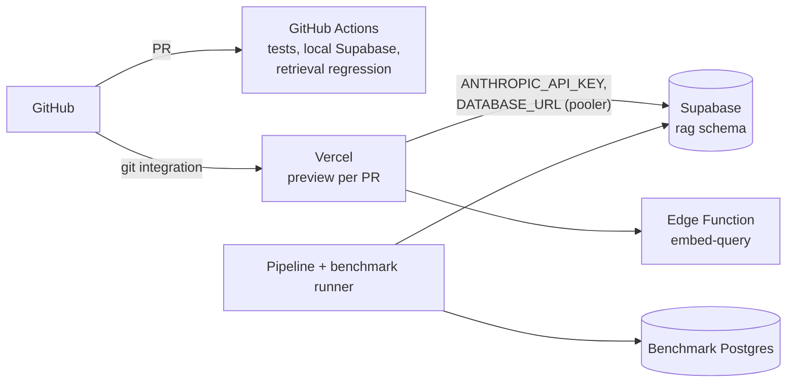

# Architecture

Chunking Lab is an experimental platform for measuring how **document
structure, chunking strategy, retrieval mode and context construction** affect
retrieval quality and answer accuracy, run over **1,000+ SEC 10-K filings**.
The source filings stay at the SEC; the platform owns a canonical, hierarchical
representation of each filing with stable character offsets, and everything
else (chunks, embeddings, indexes, benchmarks) is defined against it.

Related: [TEST_STRATEGY.md](TEST_STRATEGY.md) (benchmarks and tests),
[PLAN.md](PLAN.md) (scope, milestones, decisions).

---

## 1. Design principles

| # | Principle | Consequence |
|---|-----------|-------------|
| P1 | **Sources stay remote** | Filings are fetched from sec.gov by accession number and never re-hosted. Only the derived canonical text and metadata are stored, each linked back to its source URL with the source file's SHA-256. |
| P2 | **One canonical representation** | Every filing is parsed once into a document tree with stable character offsets. Chunking strategies, gold answer spans, search units and context windows are all **spans over that representation**, not copies of text. |
| P3 | **Strategies are layouts, not copies** | A chunking strategy produces an ordered list of `(start, end)` offsets per filing. Storing a strategy costs a few integer arrays per filing; text is always sliced from the canonical text. |
| P4 | **Separate the questions** | The *chunking benchmark* measures the chunks themselves (no retrieval). The *retrieval benchmark* measures what reaches the model's context. The *answer benchmark* measures the answers. Each has its own metrics and runs. |
| P5 | **Context construction is a variable** | Retrieval returns ranked units; a separate, versioned **context constructor** turns them into the model's context under a token budget. Static concatenation is one policy; hierarchical/dynamic expansion is another. |
| P6 | **Measure what ships** | The benchmark and the live site call the same SQL search and context functions. A parity test proves the hosted index ranks exactly like the benchmark index. |
| P7 | **Show the engineering** | The UI's primary job is to expose the corpus, the layouts, the retrieval trace and the metrics. The answer box is one panel among several. |

---

## 2. System overview



| Component | Technology | Responsibility |
|-----------|------------|----------------|
| `pipeline/` | Python 3.12 (uv) | SEC connector, parsing, canonicalisation, chunkers, embedding, loading, benchmark runners, statistics |
| `supabase/` | SQL migrations, one Edge Function | Schema, integrity triggers, `search_units()`, `build_context()`, `pareto_frontier()`, stats views; query embedding function |
| `apps/web/` | Next.js App Router, TypeScript, Tailwind, shadcn/ui | UI, API routes, answer generation, output validators |
| `packages/contracts/` | JSON Schema | Answer schema and context-span schema shared by TypeScript and Python |

---

## 3. Corpus

| Property | Value |
|----------|-------|
| Source | SEC EDGAR, form **10-K** |
| Universe | S&P 500 constituents (pinned constituent list, dated), mapped to CIKs via SEC `company_tickers.json` |
| Years | Fiscal years 2024 and 2025, about **1,000 filings** minimum; the pipeline is size-agnostic |
| Sections | Item 1 (Business), 1A (Risk Factors), 7 (MD&A), 7A (Market Risk) |
| Excluded | Financial statements and exhibits. Reported figures come from the XBRL company-facts API, which is exact, instead of from parsed statement tables |
| Expected size | ~40k tokens per filing in scope, **~40M tokens** in total (measured at load and shown in the UI) |

The four items were chosen because they are long, heterogeneous narrative with
embedded tables, nested headings and cross-references: exactly where chunking
decisions matter.

---

## 4. Ingestion pipeline



- **Resumable and idempotent.** `ingest_jobs` keys each filing by accession number
  and records its last completed stage. Re-runs skip finished work; failures are
  retried with a cap and reported, never silently dropped.
- **Incremental.** New 10-Ks are discovered from the same submissions API, so a
  scheduled run can add filings as companies file them.
- **Throughput is measured, not assumed.** Each stage records documents per
  minute, tokens per second and errors; the Corpus page shows them.
- **SEC fair access.** A declared `User-Agent` with contact details and a shared
  token-bucket limiter at ≤ 10 requests per second across all workers.
- **Source modes.** `FilingSource` takes filings from the SEC or from a local raw
  cache: `sec` always downloads (production), `cache-first` uses a valid cached copy
  or downloads and stores it (parser development), `cache-only` never touches the
  network, `refresh` re-downloads and overwrites.
- **Per-stage telemetry from the first filing.** Wall and CPU time, bytes in and out,
  and stage counts go to `ingest_events`; transfer, embedding and LLM usage go to the
  separate categories of the usage ledger (section 10.1).

### 4.1 Raw SEC cache (disposable, development only)

Source filings stay at the SEC and are not part of the product. While the parser is
being developed, though, re-downloading the same filings after every parser fix is
wasteful and puts needless load on the SEC, so each filing is downloaded **once** and
kept in a local cache:

- **Location:** `data/raw/sec/<cik>/<accession>/<document>`, or `CHUNKING_LAB_RAW_DIR`.
- **Fingerprinted:** every file has a sidecar (`.meta.json`) with its SHA-256, size,
  original transfer size and fetch time. Files are re-fingerprinted on every read; a
  mismatch is never used (`cache-first` discards and re-downloads it, `cache-only`
  stops). Writes are atomic.
- **Never committed or deployed:** `data/raw/` is in `.gitignore` and `.vercelignore`;
  the cache refuses to open if its directory is inside a git repository but not
  ignored; a test fails if any file under `data/raw` is tracked.
- **Disposable:** `chunking-lab cache stats | verify | clear --yes`. Deleting it costs only
  download time. The cache is not read in production ingest (`sec` mode), and parsed
  results never depend on it: a filing's identity is its accession number plus the
  fingerprint of the bytes it was parsed from, recorded on `filings.source_sha256`.

---

## 5. Canonical hierarchical representation

### 5.1 Tree



Node types: `document`, `item`, `section` (nested headings), and leaf blocks
`paragraph`, `table`, `list`. Every node stores `start_char`, `end_char`, `depth`,
`ordinal` (pre-order), `heading_path` and `token_count`. Sentence boundaries are
stored as an offset array on each leaf block rather than as separate rows,
which keeps the table small while preserving sentence-level addressing.

### 5.2 Canonical text rules

The canonical text is a deterministic serialisation of the tree:

- Unicode NFC; whitespace collapsed within blocks; one blank line between blocks.
- Headings are emitted as their own lines so they belong to the text and can be
  cited and embedded.
- Tables are serialised row by row as `cell | cell | cell`, with the header row
  repeated in the table node's metadata.
- Characters outside the Basic Multilingual Plane are replaced, so offsets mean the
  same thing in Python (code points), Postgres (`substr`) and JavaScript (UTF-16).

### 5.3 Stable offsets

- A filing's canonical text is identified by `(accession_no, parser_version)` and
  verified by `canonical_sha256`.
- The database **refuses** to change the canonical text of a filing that chunks or
  gold spans point into (trigger), and **refuses** any gold span whose quote does
  not match the text at its offsets (trigger).
- A new parser version produces a new representation; gold spans are migrated by
  re-anchoring their quotes, and any span that can't be re-anchored exactly is
  flagged for review.
- The original document is always one click away: `source_url` points to sec.gov,
  and `source_sha256` proves which bytes the representation came from.

---

## 6. Chunking: configurations, layouts and sweeps

A **strategy** is a family; a **configuration** is a strategy plus parameters.
Every configuration is its own immutable component version with a deterministic
name, for example `chunker/fixed.s480.o15@1.0.0` (480-token windows, 15% overlap).
Nothing about a configuration is implied by its strategy name.



| Strategy | Boundary rule | Index-time parameters |
|----------|---------------|-----------------------|
| `fixed` | Token windows, structure-blind | `size`, `overlap_pct` |
| `recursive` | Paragraph boundaries, then sentences, then tokens, to a target; may span sections | `target`, `overlap_pct` |
| `sentence` | Whole sentences packed to a limit | `max_tokens` |
| `structural` | Follows items, sections and blocks; never crosses a section; packs blocks, splits long blocks on sentences | `max_tokens` |
| `semantic` | New chunk where adjacent-sentence similarity drops; never crosses an Item | `percentile` (of the document's own distances) or an absolute `distance` |
| `hierarchical` | Small structure-aligned **atomic** units retrieved, then expanded through the tree at query time (section 8.2) | `atomic` |

### 6.1 Index-time and query-time parameters

The cost of a parameter decides how it is swept.

| Kind | Parameters | Consequence |
|------|------------|-------------|
| **Index-time** (changes the chunks) | size, overlap, boundary rule / strategy, semantic breakpoint, atomic unit size | Each value is a new layout and a new embedding set |
| **Query-time** (applied when retrieving) | `k`, retrieval `mode`, context `budget_tokens`, `parent_expansion` (levels up the tree), `neighbor_expansion` (± adjacent blocks) | Swept without re-embedding anything; recorded on `retrieval_configs.params` |

The sweep grids live in `pipeline/chunking_lab/sweeps.py`. The **primary experiment**
has **42 index-time configurations**, all inside the embedder's native window, with
chunk sizes **128 / 256 / 384 / 480** (fixed: 4 sizes × 4 overlaps; recursive: 4 × 3;
structural 4; sentence 2; semantic 4 breakpoints; hierarchical 4 atomic sizes) and 324
query-time combinations (3 modes × 4 k × 3 budgets × 3 × 3 expansions). A separate
**secondary experiment** covers chunks larger than the window (section 6.3).

### 6.2 Staged evaluation

Embedding all 42 primary configurations over the whole corpus is about 2.0 billion
tokens, so the grid is not embedded blindly. Each configuration moves through
stages, and only the ones that earn it advance:

| Stage | What runs | Corpus | Cost |
|-------|-----------|--------|------|
| **Intrinsic** | Chunking-benchmark metrics for every configuration (size distribution, boundary alignment, structural integrity, answer-span containment) | All filings | Free: no embeddings, no model calls |
| **Screening** | Shortlisted configurations embedded and scored on the dev questions, with the full query-time grid | The filings holding the dev questions' evidence plus a fixed set of distractor filings | Embedding only the screening corpus |
| **Full** | Pareto-optimal and hypothesis-critical configurations embedded and scored on the test questions | **Entire corpus (1,000+ filings)** | Embedding the whole corpus once per configuration |

The final comparison is always on the full corpus. Screening only decides which
configurations are worth embedding there, and screening results are labelled as
such wherever they are shown. The wall time of the grid depends almost entirely on
embedding throughput: 2.0 billion tokens is about 6 hours at 100,000 tokens/s, 56 hours at
10,000 and 185 hours at 3,000. Throughput is therefore measured on the first
filings (ingest telemetry) before any grid is scheduled, and replaces every assumed rate.

### 6.3 Embedding window and the long-chunk experiment

`gte-small` reads at most 512 tokens including two special tokens and a context
prefix (`Company · FY · Item · heading`, at most 24 tokens), so **480 content tokens**
is the largest chunk it embeds natively; 480 stands in for the conventional "512".

**The primary experiment stays inside that window** (128 / 256 / 384 / 480). Chunk size
is then the only thing that varies. A chunk larger than the window needs either
truncation (the model silently drops the tail) or several window embeddings that are
aggregated, and both are a second variable that would confound the size curve. So:

- every chunker **rejects sizes above 480** unless `allow_windowed=True` is passed;
- primary sweeps, curves and Pareto frontiers never include windowed configurations
  (`experiments.is_primary` marks them apart; a test asserts the primary grid is
  entirely native-window);
- chunks above the window are studied only in the **secondary `long-chunk-windowed`
  experiment**: fixed 768 and 1,024-token chunks, each embedded two ways
  (`truncate` to the first window, and `mean_windows`, which averages the per-window
  vectors and renormalises), compared with the 480-token chunks. It asks whether
  aggregation recovers what truncation loses; its results are reported separately and
  are not used to choose the production configuration.

### 6.4 Layouts, units and what is stored

- A layout row holds `starts[]`, `ends[]`, `token_counts[]` and `node_ids[]` for
  one document and one configuration. Text is never copied; it is sliced from the
  canonical text, so any configuration is cheap to keep and always available for
  the boundary visualisation.
- Units (the embedded, keyword-indexed rows) exist only for embedding sets that
  were built. `embedding_sets.retention` marks them `ephemeral`, `retained` or
  `production`; ephemeral sets are dropped once their results are recorded.
- Each unit references the smallest tree node containing it (`node_id`), which is
  what lets the context constructor move from a hit to its parent and neighbours.
- Every measured point (configuration, stage, quality, cost) is written to
  `sweep_points`, from which the Pareto frontier is computed in SQL.

---

## 7. Embeddings

- Model: **`gte-small`** (384 dimensions), Supabase's built-in embedding model.
- **Corpus embeddings** are computed offline in the pipeline with the same model
  weights (`Supabase/gte-small`, ONNX), mean pooling and normalisation, batched by
  length, and cached by `sha256(model, text)`.
- **Query embeddings** at runtime come from a Supabase Edge Function using
  `Supabase.ai.Session('gte-small')`.
- A **parity test** embeds a fixed sample both ways and requires cosine similarity
  ≥ 0.999. Without it, a silent mismatch would degrade every result.
- Stored as `halfvec(384)` (768 bytes per unit).
- Volume depends on the configuration: every configuration embeds roughly the corpus
  token count (overlap multiplies it by 1 / (1 − overlap); semantic chunking also embeds
  every sentence once). The whole 42-configuration primary grid is about 2.0 billion tokens, which
  is why it is staged (section 6.2) and why throughput is measured from the first filing.
  Corpus embedding is a batch job, run on a GPU or many-core CPU, and fully cached for re-runs.

---

## 8. Retrieval and context construction

### 8.1 Search

`rag.search_units()` serves both the live site and the benchmarks. It searches
one embedding set, so the chunker, embedder and keyword analyzer versions are
fixed by the argument:

```
search_units(query_embedding halfvec(384), query_text, embedding_set_id, mode,
             k, tickers[], fiscal_years[], items[], exact, candidates, oversample, rrf_k)
  -> unit_id, canonical_document_id, node_id, start_char, end_char, token_count,
     score, vector_rank, keyword_rank, vector_similarity
```

| Mode | Ranking |
|------|---------|
| `keyword` | Postgres full-text, OR-semantics query, `ts_rank_cd` |
| `vector` | Cosine similarity |
| `hybrid` | Reciprocal Rank Fusion of both candidate lists (k = 60) |
| `hybrid_rerank` | Hybrid top 50 re-scored by a cross-encoder (benchmark-first; stretch for live) |

Vector search has two paths:

- `exact = true`: full scan. **Used by every benchmark**, so ANN error never
  contaminates strategy comparisons.
- `exact = false`: **binary-quantised HNSW** over `binary_quantize(embedding)`
  (48 bytes per unit) returns `candidates × oversample` units, which are re-ranked
  by exact cosine. Used live; its recall against the exact path is measured
  (TEST_STRATEGY section 7).

Filters (company, fiscal year, item) are applied inside the function, with
pgvector's iterative index scans so filtered queries still return `k` results.

### 8.2 Context construction

`rag.build_context(unit_ids[], scores[], budget_tokens, policy, params)` returns an
ordered list of **context spans** `(document_id, start, end, tokens, role, source_unit_id)`.
It is the second half of retrieval, benchmarked as such, and it is what lets
**retrieval granularity be tuned separately from generation granularity**: small
units are retrieved for precision, and the context given to the model is larger.

| Policy | Behaviour | Parameters |
|--------|-----------|------------|
| `static` | Hits in rank order until the budget is reached; overlapping spans merged and counted once | none |
| `expand` | Each hit plus `neighbor_expansion` adjacent blocks either side, and `parent_expansion` levels of enclosing section, as far as the budget allows | `parent_expansion` 0-2, `neighbor_expansion` 0-2 |
| `dynamic` | Budgeted utility-based expansion through the tree (below) | decay, budget |



The constructor is implemented in SQL so the live site and the benchmarks run
the same code (P6), and its version and parameters are recorded on the retrieval
configuration. Whether expansion over small units beats the best static layout at
an equal token budget is the project's primary research hypothesis
(TEST_STRATEGY section 9).

---

## 9. Answer path



- Model `claude-opus-5-5` with structured output; server-side refusal fallback enabled.
- **Validated before display.** Sources stream first; the answer appears only after
  the deterministic validators run:

| Check | Catches |
|-------|---------|
| V1 schema | Malformed output |
| V2 citation existence | Source IDs that were not in the context |
| V3 citation coverage | Claims without a source |
| V4 numeric grounding | Numbers not present in the cited spans (normalised: `$1.2 billion`, `1,200 million`, `12%`, `12 percent`) |
| V5 quote grounding | Quotations not present verbatim |
| V6 abstention consistency | `answerable = false` with claims, or claims with no evidence |
| V7 XBRL cross-check | Financial figures that disagree with the company's reported XBRL value for that period (flagged, with the official value shown) |

---

## 10. Storage and environments

| Environment | Holds | Purpose |
|-------------|-------|---------|
| **Benchmark Postgres** (local Docker or CI runner, same migrations) | Everything: canonical documents, tree, all layouts, **the embedding sets for every configuration under test**, keyword indexes | Runs the retrieval and answer benchmarks over the full corpus with no storage ceiling |
| **Hosted Supabase** (free plan, isolated `rag` schema) | Canonical documents, tree, retained layouts, the **production configuration's** embedded units, benchmark results, sweep points, stats, logs | Powers the live UI: corpus views, boundary visualisation for any retained configuration, live retrieval on the production configuration, sweep results replayed from stored points |

Which configuration is live is a single pointer (`production_config`) to a
retrieval configuration, not a property of the schema. **Hosted Supabase holds
the artifacts for the winning production configuration only**; the benchmark
corpus is never sized to fit it. The pointer is set from the full-corpus
benchmark result (the best point on the Pareto frontier for the chosen
quality/cost trade-off). Until then the hosted database holds the canonical
layer and layouts, which is enough for the Corpus and Explorer pages. The
hosted size is measured by the storage snapshots and shown on the Corpus page.

Estimated hosted footprint for 1,000 filings (re-measured after the first 100
are loaded):

| Item | Estimate |
|------|----------|
| Canonical text (TOAST-compressed) | 60–70 MB |
| Document tree (nodes) | 40–50 MB |
| Chunk layouts (integer arrays) for retained configurations | < 20 MB |
| Serving units: `halfvec(384)` + binary HNSW | 140–160 MB |
| Serving units: keyword `tsvector` + GIN | 90–110 MB |
| Benchmark results, logs | < 20 MB |
| **Total** | **~360–420 MB** of the 500 MB free plan (18 MB already used by another app) |

If the measurement after 100 filings projects past ~420 MB, the corpus is not
cut: the serving index moves to a dedicated Supabase project (a free organisation
can run two) or the project moves to the Pro plan. The architecture doesn't change.

---

### 10.1 Resource accounting

Four different costs are recorded and shown separately; they use different units and
are never added together.

| Category | What it measures | Unit | Billed? | Where recorded |
|----------|------------------|------|---------|----------------|
| **Bandwidth** | Data downloaded from remote sources (SEC filings, submissions lists, ticker maps) | bytes on the wire (compressed), decompressed bytes, requests | No (SEC fair-access limits apply) | `usage_ledger`, from the SEC client's byte meter; cache hits record bytes *avoided* |
| **Local embedding compute** | Text read by the local `gte-small` model | tokens, seconds, hence tokens per second | No per-token charge; costs machine time (or GPU rental if used) | `usage_ledger`, from the embedder |
| **Storage** | Space held in a database, per table, TOAST relation and index | bytes | Free-plan limit (500 MB hosted) | `storage_snapshots` (`rag.snapshot_storage()`) |
| **Paid generation** | Claude calls that write and grade answers | input and output tokens, dollars | **Yes** | `usage_ledger`, one entry per call with model and purpose |

`rag.usage_ledger` enforces the pairing in SQL (a `check` constraint: embedding tokens
cannot be filed under bandwidth or as LLM tokens, bytes cannot be tokens, and only
generation carries a dollar cost). `rag.resource_usage` is a view that unions the ledger
with the latest storage snapshot, grouped by category, subject and unit. Prices live in
`pipeline/chunking_lab/usage.py` and are labelled with the date they were taken from.

The ledger is written wherever the pipeline runs (the benchmark environment); a summary
is copied to hosted Supabase when results are published, so the UI can show it.

---

## 11. Data model

Layers are kept separate; each derived layer records the versions it came from,
so any stored artifact can be traced and reproduced.



| Layer | Tables | Changes when |
|-------|--------|--------------|
| Registry | `strategies`, `component_versions` (immutable) | A component's behaviour or parameters change: register a new version |
| Source | `companies`, `filings` | Never re-fetched except to verify `source_sha256`; the documents themselves are not stored |
| Canonical | `canonical_documents`, `nodes` | New parser or normaliser version produces a new document; text is immutable |
| Boundaries | `chunk_layouts` | New chunker configuration or version |
| Artifacts | `embedding_sets`, `units` | New embedder or keyword analyzer version |
| Retrieval | `retrieval_configs`, `production_config` | Query-time parameters or context builder change |
| Evaluation | `questions`, `gold_spans`, `benchmark_runs`, `retrieval_results`, `answer_results`, `chunking_results`, `experiments`, `sweep_points` | Each benchmark run |
| Telemetry and usage | `ingest_runs`, `ingest_events`, `storage_snapshots`, `ingest_jobs`, `usage_ledger` (view `resource_usage`) | Every ingest and benchmark, from the first filing |

Telemetry is recorded per filing and per stage (discover, fetch, parse, normalize,
tokenize, chunk, embed, load, verify): wall and CPU time, bytes in and out, and
stage-specific counts. `rag.snapshot_storage()` records the size of every table,
TOAST relation and index at chosen points (for example after 1, 10 and 100
filings), which is how storage per filing is projected to 1,000. Operational
tables: `query_logs`, `answer_cache`, `rate_limits`. Materialised views
`corpus_stats` and `layout_stats` feed the UI counters and are refreshed after each
load. `rag.pareto_frontier()` computes the non-dominated configurations for any
quality and cost column.

---

## 12. User interface

The UI is a window onto the system, not a chat box. Every page answers "what is
the system doing and how well?"

| Page | Shows |
|------|-------|
| **Corpus** | Filings, companies, fiscal years, tokens, tree nodes, sentences; per-configuration chunk counts, token distributions and embedded units; ingestion throughput and failures; and a **Resource usage** panel with four separate sections (below) |
| **Explorer** | One filing: the item/section tree beside the canonical text; **chunk boundaries for any strategy drawn as bands**, two strategies overlaid for comparison; token count per chunk; gold spans highlighted; link to the original on sec.gov |
| **Retrieval Lab** | Two modes. **Query:** run a question against a chosen configuration, mode, `k`, budget and expansion: ranked units with vector rank, keyword rank and fused score; the **constructed context** as a budget bar (hit / neighbor / parent / heading segments) and as highlighted passages in their filings; latency per stage. **Tuning:** see below |
| **Tuning** (in Retrieval Lab) | Controls for chunk size, overlap, boundary strategy, semantic threshold, atomic unit size, `k`, budget and expansion. Index-time controls snap to the precomputed sweep grid and show recorded results; query-time controls re-run **live** against the dev questions on the production configuration. Output: quality (Recall@5, MRR, answer-span containment, Full-Evidence Rate, answer accuracy where measured) beside cost (chunks, tokens embedded, index size, mean context tokens, p95 retrieval and answer latency); change one control and the deltas show. Every number is labelled with its stage (intrinsic / screening / full) |
| **Benchmarks** | Four tabs: **Sweeps** (parameter-performance curves, one per swept parameter, and the quality-versus-cost **Pareto frontier**, with the chosen production configuration marked), and the three below: **Chunking** (boundary alignment, fragmentation, size distributions and answer-span containment per configuration), **Retrieval** (Hit@k, MRR, nDCG, Context Recall and Full-Evidence Rate vs token budget, with confidence intervals; per-question drill-down showing which gold characters each configuration recovered), **Answers** (correctness, faithfulness, abstention, validator catch rates, baselines) |
| **Ask** | Validated answer with claim-level badges and citations; the Retrieval Lab trace for that answer is one click away |
| **Method** | Corpus definition, strategies, metrics, hypotheses, limitations, SEC attribution, and a plain-language **What this costs** section explaining the four resource categories |

**Resource usage panel (Corpus and Method pages).** Four labelled sections, with no combined
total: **Bandwidth** (SEC bytes downloaded on the wire and decompressed, requests, bytes
avoided by cache hits), **Local embedding compute** (tokens embedded, seconds,
tokens per second, per configuration), **Storage** (bytes by table and layer, hosted versus
benchmark, against the free-plan limit), and **Paid generation** (Claude input/output
tokens and dollars, by model and purpose: answering, judging). Each section states its
unit and whether it is billed, so a visitor can tell a download size from an embedding
token count from a dollar amount.

Design: editorial and data-dense. A serif display face with a clean sans and a
monospaced face for figures; light and dark themes; one consistent chart palette;
⌘K command palette; responsive down to phone width. A clickable mock-up is
reviewed before the UI is built.

---

## 13. Deployment and security



- **Shared project, isolated schema.** The Supabase project also hosts another
  app; this one lives entirely in the `rag` schema and never reads or alters `public`.
- **Server-only access.** The `rag` schema is not exposed through the Data API;
  Next.js and the pipeline connect with a pooled Postgres connection string.
  RLS is enabled on every table with no policies, and `anon`/`authenticated` have
  no grants, so an accidental exposure would still return nothing.
- **Edge Function** accepts only text up to a fixed length and requires a server-held key.
- **Cost controls.** Per-IP and global daily limits on answer calls, cached answers
  for showcase questions, maximum question length.

---

## 14. Repository layout

```
.
├── apps/web/                    Next.js app
├── packages/contracts/          answer and context-span JSON schemas
├── pipeline/chunking_lab/
│   ├── sec/                     universe, discovery, fetch, rate limiter
│   ├── parse/                   inline-XBRL HTML, item segmentation, tables
│   ├── canonical/               serialiser, tree, sentence offsets, validation
│   ├── chunkers/                fixed, overlap, sentence, structural, semantic, hierarchical
│   ├── embed/                   gte-small ONNX, batching, cache
│   ├── load/                    COPY loaders, stats refresh
│   └── bench/                   chunking, retrieval, answer, ann_recall, parity, stats
├── pipeline/tests/
├── supabase/migrations/         schema, functions, triggers, RLS
├── supabase/functions/embed-query/
├── data/questions/              gold and silver question sets with spans
├── bench/results/               versioned benchmark outputs
└── docs/
```

---

## 15. Architecture decision records

| ADR | Decision | Why | Trade-off |
|-----|----------|-----|-----------|
| 1 | SEC EDGAR 10-Ks as the corpus | Real, public, immutable by accession number, deeply structured, with XBRL ground truth for figures | Domain is finance; narrative sections only |
| 2 | Canonical representation with frozen offsets | All strategies, labels and contexts are comparable spans over the same text | Parser changes require re-anchoring labels |
| 3 | Strategies stored as layouts; text never duplicated | Every strategy available for every filing at negligible cost | Text must be sliced at read time (cheap) |
| 4 | Separate benchmark database | Full-corpus, all-strategy retrieval benchmarks are not limited by the hosted plan | Two environments; kept identical by shared migrations and a parity test |
| 5 | Exact search in benchmarks, binary HNSW + exact re-rank live | Comparisons free of ANN error; live index ~16× smaller than full-precision HNSW | Live recall measured and reported |
| 6 | `gte-small` for all embeddings | Built into Supabase, no external vendor, identical model offline and online | 512-token limit, English only, weaker than large commercial models; constant across strategies, so comparisons stay fair |
| 7 | Context construction in SQL | One implementation for live and benchmark | More complex SQL; covered by dedicated tests |
| 8 | Validate before display | Never show text that may be retracted | Answer appears all at once |
| 9 | Postgres full-text + pgvector rather than OpenSearch | One store, free hosting, same hybrid concepts (BM25-style + k-NN + fusion) | `ts_rank_cd` is not BM25; noted in results |
| 10 | Strategies are families; each parameter combination is a separately versioned configuration | Sweeps need many comparable configurations without ambiguity about what was run | More registry rows; names are generated deterministically |
| 11 | Index-time and query-time parameters are separated | Query-time sweeps (k, budget, expansion) cost nothing to run; only index-time ones need embeddings | Query-time effects are measured on whichever embedding sets exist |
| 12 | Staged evaluation (intrinsic, screening, full) | The full grid is ~2.0B tokens to embed; intrinsic metrics are free and screening narrows the field | Screening uses a sub-corpus; its results are labelled and never used as the final comparison |
| 13 | The primary experiment stays inside gte-small's native 480-token window; larger chunks and multi-window aggregation are a separate experiment | Truncation or window averaging is a second variable that would confound the chunk-size curve | The primary sweep cannot say anything about chunks above 480 tokens; the secondary experiment does, separately |
| 14 | Hosted Supabase holds the production configuration only | The benchmark must not be sized to the free plan | The hosted database cannot replay every configuration's retrieval live; sweeps are shown from stored results |
| 15 | Raw SEC filings are cached locally and disposably during parser development | Parser iteration would otherwise re-download the same filings repeatedly | Cache must be policed: git-ignored, deploy-ignored, fingerprint-verified, never read in production mode |
| 16 | Four resource categories are accounted separately and never summed | Bandwidth, local embedding compute, storage and paid generation are different costs with different units and owners | The UI shows four panels, not one "cost" number |
