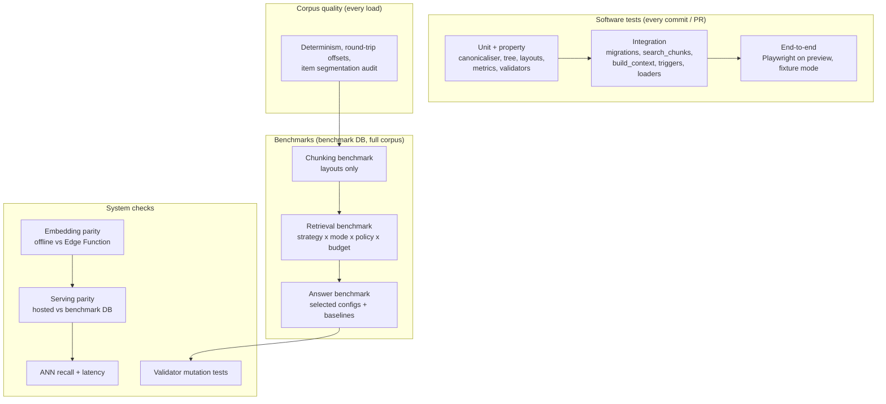

# Test and benchmark strategy

Three different questions get three separate benchmarks, plus the software
tests and system checks that make their numbers trustworthy:

| Layer | Question it answers |
|-------|---------------------|
| Software tests | Does the code do what we think it does? |
| Corpus quality checks | Is the canonical representation of each filing faithful and stable? |
| **Chunking benchmark** | What do the chunks look like? Do boundaries respect structure? Is evidence kept intact? *(no retrieval)* |
| **Retrieval benchmark** | Does the right evidence reach the model's context within a token budget? |
| **Answer benchmark** | Are the answers correct, grounded and properly abstained? |
| System checks | Do the live system and the benchmark system behave identically? How much does the fast index lose? |
| Validator tests | Do the runtime output checks catch the errors they claim to? |

Related: [ARCHITECTURE.md](ARCHITECTURE.md), [PLAN.md](PLAN.md).

---

## 1. Principles

| Principle | Consequence |
|-----------|-------------|
| Labels are spans over the canonical text | Gold evidence is strategy-independent; the same labels score every layout and every context policy |
| Measure the context, not just the ranking | The model only sees the constructed context, so the retrieval benchmark's headline metrics are computed on it, at fixed token budgets |
| Compare at equal budgets | Bigger chunks win at fixed *k* by covering more text; at a fixed token budget they have to earn it |
| Exact search for all benchmarks | ANN error never contaminates strategy comparisons; ANN loss is measured separately |
| Tune on dev, report on test | Parameters (unit size, decay, τ) are tuned on dev questions only; the test set is run once per final configuration |
| Hypotheses before results | Section 9 is fixed before the first test-set run; outcomes are reported whether confirmed or not |
| Real data only | No synthetic documents. Test fixtures are excerpts of real filings, live in the test suite, and never persist in shared databases |
| Report uncertainty | Confidence intervals on every headline number; no winner claimed when intervals overlap |

---

## 2. Map

---

## 3. Software tests

### 3.1 Canonicalisation and tree invariants

| ID | Invariant |
|----|-----------|
| T1 | Deterministic: the same source bytes and parser version give a byte-identical canonical text and tree (`canonical_sha256` stable) |
| T2 | Every node satisfies `parent.start ≤ child.start < child.end ≤ parent.end` |
| T3 | Siblings are ordered and non-overlapping; leaf blocks tile their section's body with only whitespace between them |
| T4 | Every `sentence_starts` offset lies inside its block, strictly increasing, and lands on a non-space character |
| T5 | Only BMP characters; NFC-normalised; offsets agree between Python, Postgres `substr` and JavaScript |
| T6 | Every in-scope item found exactly once, in order (1 < 1A < 7 < 7A); the table of contents is never mistaken for the item body |
| T7 | Tables serialised row by row; no cell text lost (checked against the HTML table cell count) |

### 3.2 Layout invariants (every strategy and every configuration)

| ID | Invariant | Applies to |
|----|-----------|------------|
| L1 | `text[start:end]` is exactly the chunk; spans lie inside the in-scope items | all |
| L2 | Ordered; every non-whitespace character of in-scope text is covered | all |
| L3 | No overlap between consecutive spans | configurations with `overlap_pct = 0` |
| L4 | Overlap is `round(size × overlap_pct / 100)` tokens (± 1 at boundaries) for `fixed`; for `recursive`, at most that many tokens and made of whole units | `fixed`, `recursive` with overlap |
| L5 | `token_count` ≤ the configuration's limit (480 for single-window configurations); configurations above 480 carry `embed_windowed = true` | all |
| L6 | No sentence split unless a single sentence exceeds the limit | `sentence`, `recursive`, `structural`, `semantic`, `hierarchical` |
| L7 | No span crosses a section boundary | `structural`, `hierarchical` |
| L8 | `node_id` is the smallest node containing the span | all search units |
| L9 | Deterministic | all |
| L10 | Every configuration in the sweep grids has a unique, deterministic version id (e.g. `chunker/fixed.s480.o15@1.0.0`); invalid parameters (overlap ≥ 100%, semantic with both or neither breakpoint) are rejected | all |

### 3.3 Property-based tests (Hypothesis)

Random trees (depth, heading counts, block lengths, sentence lengths, tables,
Unicode) are generated, serialised and chunked; T2–T5 and L1–L3, L5, L9 are
checked on thousands of cases per run.

### 3.4 Metrics

Every benchmark metric (span coverage, Hit@k, Recall@k, MRR, nDCG, Context
Recall, Full-Evidence Rate, Context Precision, fragmentation, boundary alignment)
is tested against small hand-worked cases, including ties, empty results,
overlapping spans and evidence split across chunks. The bootstrap is seeded and
checked against an analytic case.

### 3.5 Integration (local Supabase, `supabase start`)

- Migrations apply from scratch.
- `search_chunks`: correct order in every mode on hand-built vectors; filters
  respected; strategy isolation; exact and approximate paths agree on small sets.
- `build_context`: every policy respects the budget; spans merge correctly; roles
  are right; output is ordered by filing rank then position; the same inputs always
  give the same output.
- Triggers: a wrong gold quote is rejected; canonical text is frozen once referenced.
- Loaders: idempotent re-load; `ingest_jobs` resumes after a simulated crash.

### 3.6 End-to-end (Playwright on Vercel previews, recorded model responses)

Corpus counters render; Explorer draws boundaries for each strategy and overlays
two; Retrieval Lab shows ranks and the budget bar; Benchmarks charts and
drill-down work; Ask shows sources first, then a validated answer; unanswerable
question abstains; rate limit message; axe-core accessibility; phone viewport.

---

## 4. Corpus quality checks (every load)

| Check | Method | Gate |
|-------|--------|------|
| Determinism | Re-canonicalise a 5% sample from SEC; compare `canonical_sha256` | 100% identical |
| Item segmentation accuracy | Hand-audit 50 randomly sampled filings: item start and end within one block of the true boundary | ≥ 98%; failures fixed in the parser, not patched per filing |
| Coverage | Share of discovered filings that pass validation and load | Reported; every failure has a logged reason |
| Source integrity | `source_sha256` recorded for every filing | 100% |

---

## 5. Question sets

| Tier | Size | How it's made | Used for |
|------|------|---------------|----------|
| **Gold** | 50 (10 dev, 40 test) | Written and checked by a person against the filing | Headline retrieval and answer results |
| **Silver: XBRL numeric** | ≥ 300 | Generated from the XBRL company-facts API (e.g. revenue, operating income, segment figures for a company and year); the reported value is located in the filing's MD&A text to create the gold span; a question is kept only if the value is found exactly once in context. 10% audited by hand | Large-sample retrieval results for figure lookups; V7 validator testing |

Gold question mix (test / dev):

| Type | Test | Dev | Shape |
|------|------|-----|-------|
| Factual lookup | 6 | 2 | "What does Costco say drives membership fee income?" |
| Numeric | 6 | 2 | "By how much did Nike's gross margin change in fiscal 2025, and why?" |
| **Multi-span** (evidence in 2+ places in one filing) | 10 | 2 | "Which supply-chain risks does Apple list, and what mitigations does MD&A describe?" |
| **Synthesis** (evidence spread across a section) | 8 | 2 | "Summarise how Target describes its inventory strategy." |
| Cross-filing comparison | 6 | 1 | "How did Starbucks' description of China risk change between FY2024 and FY2025?" |
| Unanswerable | 4 | 1 | Plausible but not covered by the filings in scope |

Multi-span and synthesis are deliberately over-represented: they are where
static chunking is expected to fragment evidence and where the primary
hypothesis (section 9) lives.

Labelling rules:

- Questions are written in an analyst's words, not the filing's, to avoid
  favouring keyword search.
- Gold spans are **minimal** (sentence-level), never whole sections, so labels
  don't favour section-sized chunks.
- Every span is checked by the database trigger against the canonical text.
- Unanswerable questions are confirmed by a full-corpus keyword and vector search
  reviewed by hand.

---

## 6. Chunking benchmark (layouts only, no retrieval)

Runs over **every filing × every chunker configuration** using the layouts and
the tree. No embeddings and no model calls, so it is free and is the first stage
of every sweep (section 7.4). Results go to `chunking_results` and, per
configuration, to `sweep_points` with `stage = 'intrinsic'`.

| Group | Metric | Meaning |
|-------|--------|---------|
| Volume | Chunks; tokens embedded; **redundancy** = tokens embedded ÷ corpus tokens | Index size and embedding cost the configuration implies |
| Size | Mean, p5, p50, p95 tokens; share at the limit; share below 64 tokens; histogram | Truncation risk and fragments too small to carry meaning |
| Boundary alignment | Share of cuts on a section / block / sentence boundary; **mid-sentence cut rate** | How well cuts respect language and structure |
| Structural integrity | Chunks crossing a section boundary; **orphaned headings** (heading not in the same chunk as the start of its body); sentence, block and **table containment** (share held whole in one chunk) | Structural damage done by the cut |
| **Answer-span containment** | Computed for every gold and silver evidence span; definitions below | Upper bound on what any retriever can recover from these chunks |

### 6.1 Answer-span containment

For an evidence span *g* and the chunks *c* of a configuration:

| Metric | Definition | Reading |
|--------|------------|---------|
| **Contained rate** | Share of spans with some chunk covering all of *g* | The headline: the answer is not cut |
| Containment ≥ 80% rate | Share where one chunk covers at least 80% of *g* | Tolerant version, matching the retrieval benchmark's θ |
| Mean containment | Mean over spans of max over chunks of \|c ∩ g\| ÷ \|g\| | Average share of the answer one chunk holds |
| **Cover count** | Fewest chunks whose union covers ≥ 80% of *g* | Chunks the retriever must get right; 1 is ideal |
| **Dilution** | \|g\| ÷ size of the smallest chunk fully containing *g* | Share of that chunk that is evidence; large chunks contain more answers but dilute them |

Containment rises with chunk size while dilution falls, which is exactly the
size trade-off the sweeps measure; containment is an upper bound on retrieval
recall for a configuration, and the gap between the two is retrieval error.
Reported per configuration, per item, per question type (multi-span evidence is
split across more chunks) and as distributions, not just means. Metric code
lives in `pipeline/chunking_lab/metrics.py` and is tested against hand-worked
spans (section 3.4).

---

## 7. Retrieval benchmark

### 7.1 Configurations

| Factor | Levels |
|--------|--------|
| Chunker configuration | The index-time grids in `pipeline/chunking_lab/sweeps.py`: fixed (size × overlap), recursive, structural, sentence, semantic, hierarchical (atomic size) |
| Mode | `keyword`, `vector`, `hybrid` (+ `hybrid_rerank`) |
| Context policy | `static` (all configurations); `expand` with `parent_expansion` and `neighbor_expansion` of 0-2; `dynamic` (hierarchical units) |
| `k` | 3 / 5 / 10 / 20 |
| Budget | 2,000 / 4,000 / 8,000 tokens (1,000 for the smallest-budget curve) |

Index-time parameters need a new embedding set per value; query-time ones (mode,
`k`, budget, expansion) are free to sweep. The sweeps run in stages (section
7.4). Final comparisons run on the benchmark database over the **full corpus**,
exact search, no metadata filters (filters are a separate experiment: same questions with
company and year filters supplied).

### 7.2 Ranking metrics (before context construction)

A gold span is **found at rank r** when the union of the top-r units covers at
least θ = 80% of its characters (θ = 50% and 100% reported as sensitivity).

| Metric | Definition |
|--------|------------|
| Hit@k (1, 5, 10, 20) | Share of questions with any gold span found within k |
| Recall@k | Share of each question's gold spans found within k, averaged |
| MRR | Mean 1 / rank of the first found span |
| nDCG@10 | Binary-relevance ranking quality |

### 7.3 Context metrics (headline)

| Metric | Definition |
|--------|------------|
| **Context Recall@B** | Gold characters inside the constructed context ÷ all gold characters |
| **Full-Evidence Rate@B** | Share of questions whose gold spans are **all** fully inside the context. The closest single number to "the model had everything it needed" |
| Context Precision@B | Gold tokens ÷ context tokens |
| Fragments@B | Number of separate spans in the context (readability for the model) |
| Budget used | Tokens actually used ÷ B |

Results are plotted as **budget curves** (metric vs B) per configuration, with
95% confidence intervals, and broken down by question type.

---

### 7.4 Tuning sweeps and the Pareto frontier

The question is not "which chunk size wins?" but **how quality trades against
cost as each parameter moves**. There is no universal best configuration:

> Quality = f(chunk size, overlap, boundary rule, retrieval mode, k, context budget, expansion, corpus, question type)

**Design.**

- One-factor-at-a-time curves for every parameter, and the full size × overlap
  factorial for `fixed`, so interactions are visible (for example, overlap spends
  context budget on duplicated text).
- Every measured configuration is one `sweep_points` row holding **quality**
  (Recall@5, MRR, answer-span containment, Full-Evidence Rate, answer accuracy
  where measured) and **cost** (chunks, tokens embedded, index bytes, mean context
  tokens, retrieval p95, answer p95), tagged with its stage.
- Stages (ARCHITECTURE section 6.2): *intrinsic* on all filings for every
  configuration; *screening* on the screening corpus with the query-time grid for
  shortlisted configurations; *full* on the whole corpus and the test questions for
  Pareto-optimal and hypothesis-critical configurations only.

**Pareto frontier.** A configuration is on the frontier when no other has at least
its quality at no more than its cost, with one strictly better
(`rag.pareto_frontier()`). Pairs reported:

| Quality | Cost |
|---------|------|
| Full-Evidence Rate | Mean context tokens |
| Recall@5 | Index size (bytes) |
| Answer accuracy | Mean context tokens |
| Answer accuracy | p95 answer latency |

The production configuration is chosen from the frontier on the **dev** questions,
under a stated budget (for example, minimum cost within one confidence interval of
the best Full-Evidence Rate), and recorded in `production_config` with the run that
justified it.

**Guarding against overfitting the sweep.** Selecting the best of 41+ configurations
on any question set inflates its score, so:

- selection uses dev questions only; the test questions are run once, on the
  selected and pre-declared reference configurations;
- the number of configurations tried is reported with every "best" claim;
- curves carry confidence bands; where neighbouring points overlap no optimum is
  claimed and the result is reported as a plateau;
- screening results are always labelled as screening and never used as the final comparison.

Every result is specific to this corpus, this embedder and this question set; the
write-up says so, and gives the curves rather than a recommended number.

---

## 8. Answer benchmark

Runs on a shortlist chosen from retrieval results on the **dev** set (best
static configuration, best hierarchical configuration, and the fixed-size
baseline) at B = 2,000 and 4,000, plus two baselines:

| Baseline | Model gets | Tells us |
|----------|-----------|----------|
| Closed-book | Question only | How much the model knows already; public filings may be partly memorised |
| Oracle | Exactly the gold spans | Ceiling with perfect retrieval |

| Metric | Method |
|--------|--------|
| Correctness | LLM judge vs reference: correct / partial / incorrect |
| Key-fact recall | Judge marks each key fact present or absent |
| Numeric accuracy | Deterministic match against the reference value (silver set: XBRL value) |
| Faithfulness | Judge checks each claim against its cited spans only |
| Citation accuracy | Share of answers citing a span that overlaps gold evidence |
| Abstention | Correct abstentions on unanswerable; false abstentions on answerable |
| Validator outcome | Share verified / partially verified / abstained |

**Judge:** `claude-opus-5-5` at high effort with structured output and a fixed
rubric; blind to configuration; candidate order shuffled; every judgement run
twice. Before use, it is calibrated against 50 human-graded answers. Cohen's
kappa must be ≥ 0.7, otherwise the rubric is revised and calibration repeated.

---

## 9. Hypotheses (fixed before the first test-set run)

### Primary: dynamic context construction

> **H1.** At an equal token budget, hierarchical units with dynamic context
> construction achieve a higher **Full-Evidence Rate** than the best static layout.

| ID | Sub-hypothesis | Decision rule |
|----|----------------|---------------|
| H1a | H1 holds at B = 2,000 and B = 4,000 | Paired bootstrap 95% CI of the difference excludes 0 at both budgets |
| H1b | The gain is concentrated in multi-span and synthesis questions; little or none for factual and numeric lookups | Per-type differences (exploratory, reported with CIs) |
| H1c | Dynamic construction needs fewer tokens to reach the same Context Recall as the best static layout | Budget at which each reaches Context Recall 0.8, read from the curves |
| H1d | `dynamic` beats the simpler `expand` policy (fixed parent / neighbour expansion) on the same units | Same rule as H1a |
| H1e | Retrieval gains carry through to answers: higher key-fact recall and faithfulness at equal budget | Answer benchmark, same rule |

If H1 is rejected, that is a reported result: it would mean a well-tuned static
structural layout is as good as query-time construction on this corpus, and the
budget curves show by how much.

### Secondary

| ID | Hypothesis | Measured by |
|----|------------|-------------|
| H2 | Structure-aware layouts (`structural`, `hierarchical`) have far fewer mid-sentence splits, orphaned headings and fragmented tables than `fixed` | Chunking benchmark |
| H3 | Intact-evidence rate (chunking benchmark) predicts Full-Evidence Rate (retrieval benchmark) across layouts | Rank correlation across the six layouts (descriptive, n = 6) |
| H4 | Overlap improves Recall@k over `fixed` but not Full-Evidence Rate at equal budget, because duplicated tokens consume budget | Retrieval benchmark |
| H5 | Hybrid beats vector-only on numeric and named-entity questions | Hit@5 by question type |
| H6 | Semantic chunking is no better than sentence packing at equal budget | Full-Evidence Rate@2,000 |
| H7 | Closed-book accuracy is materially above zero, so faithfulness and citation accuracy are needed to show retrieval's value | Answer benchmark baselines |
| H8 | There is no single best chunk size: the size maximising Hit@5 differs between question types (for example numeric lookup versus synthesis) | Argmax of the size curve per type, with confidence bands (exploratory) |
| H9 | Overlap has diminishing returns: the Recall@5 gain per added embedded token from 20% to 30% overlap is smaller than from 0% to 20%, and at an equal context budget overlap does not raise Full-Evidence Rate | `fixed` size × overlap grid |
| H10 | Chunk size and context budget are partly interchangeable: hierarchical atomic units of 128-256 tokens with expansion reach the best static Full-Evidence Rate at lower mean context tokens | Pareto frontier, Full-Evidence Rate vs mean context tokens |

---

## 10. System checks

| Check | Method | Target |
|-------|--------|--------|
| **Embedding parity** | 500 texts embedded offline (ONNX) and by the Edge Function | cosine ≥ 0.999 for every text |
| **Serving parity** | For the serving strategy, run the dev questions through `search_chunks(exact = true)` on hosted and benchmark DBs | Identical rankings |
| **ANN recall** | Hosted approximate path (binary HNSW + exact re-rank) vs exact path, same questions | Recall@10 ≥ 0.97; reported, with the oversample setting |
| **Latency** | p50 / p95 per stage (embed, search, context, model, validation) on the hosted stack | Search < 100 ms p50; sources visible < 1.5 s p50 |
| **Ingestion throughput** | Filings per minute and tokens per second per stage, from `ingest_jobs.metrics` | Reported on the Corpus page |

---

## 11. Validator mutation tests

Correct answers from the answer benchmark are mutated automatically:

| Fault | Example |
|-------|---------|
| Number changed | `$94.9 billion` → `$49.9 billion` |
| Unit or scale changed | `million` → `billion` |
| Period changed | FY2025 figure attributed to FY2024 |
| Citation to a span not in context | `S7` when only `S1–S5` exist |
| Citation removed | Claim with empty `source_ids` |
| Fabricated quotation | Quoted text absent from sources |
| Inconsistent abstention | `answerable = false` with claims |

Reported per fault: **catch rate** (target 100% for structural faults, ≥ 95%
for numeric) and **false-alarm rate** on unmutated answers (≤ 5%).

---

## 12. Statistics

- All comparisons are **paired** over the same questions.
- 95% confidence intervals from a paired bootstrap over questions (10,000 resamples, seeded).
- Binary per-question outcomes (Hit@k, full evidence) also get McNemar's exact test.
- Gold (n = 40 test) supports only large effects; the silver set (n ≥ 300)
  supports finer comparisons for numeric lookup. The two are always reported
  separately.
- Per-type breakdowns are labelled exploratory.
- Multiple comparisons: the primary hypothesis H1a is the one confirmatory test;
  all other comparisons are reported as estimates with intervals.

---

## 13. Error analysis

Every failure in the gold test set gets one cause:

| Code | Cause |
|------|-------|
| C-SPLIT | Evidence split across units; only part retrieved |
| C-BUDGET | Evidence retrieved but cut by the budget |
| R-MISS | Evidence not in the top results at all |
| R-LOW | Evidence ranked too low to enter the context |
| G-IGNORE | Evidence in context, not used |
| G-WRONG | Evidence used but misread (wrong period, unit, segment) |
| G-ABSTAIN | Abstained despite having the evidence |
| J-ERR / L-ERR | Judge or label error (fixed and logged) |

The cause distribution per configuration is published with the results.
C-SPLIT and C-BUDGET are the failures chunking and context construction directly control.

---

## 14. CI gates

| Trigger | Runs | Blocks merge when |
|---------|------|-------------------|
| Every push / PR | ruff, mypy, pytest (unit, property), eslint, tsc, vitest, question-set checks | Any failure |
| Every PR | Integration on local Supabase; Playwright on the preview | Any failure |
| PR touching `pipeline/`, `supabase/` or retrieval code | Chunking benchmark on a fixed 50-filing slice; retrieval benchmark on the dev set (cached embeddings, no model calls) | Any primary metric drops more than 3 points vs the committed baseline in `bench/baselines/` |
| Manual | Full chunking, retrieval and answer benchmarks; system checks | Never blocks; results committed under `bench/results/<run_id>/` and loaded into `rag.benchmark_runs` |

Every run records the git SHA, parser version, strategy versions and parameters,
context policy, model IDs, seeds and the corpus snapshot (filing count and
`canonical_sha256` list), so every published number can be reproduced.

---

## 15. Definition of done (publishing results)

- [ ] ≥ 1,000 filings loaded; corpus quality gates passed.
- [ ] All CI gates green.
- [ ] Gold set reviewed; silver audit done.
- [ ] Chunking benchmark complete for every configuration in the sweep grids.
- [ ] Sweeps complete through their stages; parameter curves and Pareto frontiers published; production configuration chosen on dev and recorded.
- [ ] Retrieval benchmark complete for all configurations and budgets.
- [ ] Judge calibrated (kappa reported); answer benchmark complete with baselines.
- [ ] Embedding parity, serving parity and ANN recall reported.
- [ ] Validator mutation results reported.
- [ ] Hypotheses table filled in with outcomes, including rejections.
- [ ] `docs/RESULTS.md` written from committed runs, with limitations.
