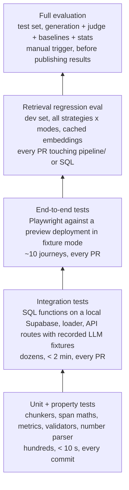

# Test and evaluation strategy

This project has two kinds of "testing", and both matter:

1. **Software testing.** Does the code do what we think it does? (Chunkers, metrics,
   SQL, validators, UI.)
2. **Evaluation.** Does the *system* give the right passages and the right answers,
   and which chunking strategy is better? (Golden questions, retrieval metrics,
   answer grading, statistics.)

A third layer, **runtime output validation**, runs on every live answer and is
itself tested (section 7).

Related: [ARCHITECTURE.md](ARCHITECTURE.md), [PLAN.md](PLAN.md).

---

## 1. Principles

| Principle | Consequence |
|-----------|-------------|
| Measure retrieval and generation separately | When an answer is wrong, we can say whether the right passage was never found or the model misused it |
| Labels must not favour any strategy | Gold answers are character spans in the canonical text, not chunk IDs (ADR-3) |
| Measure what ships | The eval calls the production SQL function and the production `/api/answer` route |
| Tune on dev, report on test | 10 dev questions for tuning; 30 test questions locked and run once per final configuration |
| Report uncertainty | 30 questions is a small sample; every headline number gets a 95% confidence interval |
| Real data only | The corpus is real published research; test fixtures live in test code and are created and destroyed by the tests themselves, never left in the shared database |
| Write hypotheses before results | Section 9 is written before the test set is first run |

---

## 2. Test pyramid

---

## 3. Unit tests (pytest, vitest)

### 3.1 Chunker invariants

Every chunker is run against a set of real-structure fixtures (short excerpts
with headings, lists, tables, very long paragraphs, very short sections, Unicode
punctuation) and must satisfy:

| ID | Invariant | Applies to |
|----|-----------|------------|
| C1 | `chunk.text == doc.text[start_char:end_char]` (chunks are exact slices) | all |
| C2 | Chunks are ordered and **cover the document**: every non-whitespace character belongs to at least one chunk | all |
| C3 | No overlap between consecutive chunks | all except `fixed_overlap` |
| C4 | Overlap equals the configured token count (± one token at boundaries) | `fixed_overlap` |
| C5 | `token_count <= max_tokens` (one tokenizer for all strategies) | all |
| C6 | No sentence is split across chunks unless a single sentence exceeds `max_tokens` | `sentence`, `section`, `semantic` |
| C7 | No chunk crosses a section boundary (except where tiny sections are merged, and then the merge is recorded) | `section` |
| C8 | `heading_path` equals the heading path at `start_char` | all |
| C9 | Deterministic: same input and config produce byte-identical output | all |
| C10 | No empty or whitespace-only chunks | all |

### 3.2 Property-based tests (Hypothesis)

Random documents are generated (random heading trees, paragraph lengths,
sentence lengths, Unicode) and C1, C2, C3, C5, C9 and C10 are checked on
thousands of cases per run. This finds the off-by-one and edge-case bugs that
hand-written fixtures miss. (The schema smoke test already caught one: a span
ending one character past the document.)

### 3.3 Span and metric maths

- Span overlap and coverage functions: hand-computed cases (touching spans,
  nested spans, spans split across two chunks, zero-length guards).
- Recall@k, MRR, nDCG@k and Recall@token-budget: tested against small
  hand-worked rankings, including ties, no relevant result, and multiple gold spans.
- Bootstrap: seeded, so results are reproducible; checked against a known analytic case.

### 3.4 Validators (TypeScript, vitest)

Each validator in ARCHITECTURE section 6.2 gets table-driven tests, with
special weight on the number parser:

| Input in answer | Must match in source |
|-----------------|----------------------|
| `45%` | `45 percent`, `45 per cent`, `45%` |
| `1,200` | `1200`, `1,200` |
| `half` | `50%` is **not** auto-matched (only digits and percentages are normalised; spelled-out approximations are flagged, not guessed) |
| `2019` | treated as a year, still must appear |
| `3.5` | `3.5`, not `35` |

---

## 4. Integration tests

| Area | How | Checks |
|------|-----|--------|
| Schema and SQL | `supabase start` (local Postgres + pgvector in Docker) applies `supabase/migrations/` from scratch | Migration applies cleanly; `search_chunks` returns the right order for hand-built vectors in all three modes; RRF maths; strategy isolation (never returns another strategy's chunks); gold-span trigger rejects a wrong quote; canonical-text freeze; `verify_chunks()` flags a bad span; rate limiter allows N then blocks |
| Loader | Pipeline run over three fixture documents into the local DB | Row counts, `verify_chunks()` returns zero rows, idempotent re-load |
| API routes | Next.js route handlers with the Claude and Voyage clients replaced by recorded responses | Event order (`sources` then `answer`), validation object shape, 429 on rate limit, abstention path |
| Contract | `packages/contracts/answer.schema.json` | The TypeScript zod schema and the Python eval parser accept and reject the same fixture set |

No integration test touches the hosted Supabase project.

---

## 5. Golden dataset

### 5.1 Composition

40 questions over the real corpus: **10 dev, 30 test**, with the same type mix in both.

| Type | Test | Dev | Example shape |
|------|------|-----|---------------|
| Factual lookup | 8 | 3 | "What reason did respondents most often give for ...?" |
| Numeric / table | 8 | 3 | "What share of adults under 30 said ... in 2023?" |
| Multi-section synthesis | 6 | 2 | "What are the main barriers the report identifies, and how do they differ by age?" |
| Cross-report comparison | 4 | 1 | "How did the figure for ... change between the 2019 and 2024 reports?" |
| Unanswerable | 4 | 1 | Plausible question whose answer is not in the corpus |

### 5.2 Each question records

`id`, `split`, `qtype`, `question`, `reference_answer`, `key_facts` (the 1–4
atomic facts a correct answer must contain), `answerable`, `author`,
`reviewed_by`, and one or more **gold spans** (`document`, `start_char`,
`end_char`, `quote`): the minimal passage(s) that justify the answer.

### 5.3 How questions are written

1. Read a report section; write the question **in a researcher's words, not the
   report's**. Avoid copying distinctive phrases, which would unfairly favour
   keyword search.
2. Mark the **minimal** answer span (sentence-level), not the surrounding section.
   Section-sized labels would favour the section chunker.
3. Claude may *suggest* candidate questions from passages; every one is rewritten
   or approved by a human, and `author` records which.
4. A second pass (`reviewed_by`) checks the answer is unambiguous and correct.

### 5.4 Automated dataset checks (run in CI)

- Schema check of `data/questions/questions.yaml`.
- Every `quote` equals the canonical text at its offsets (also enforced by a DB trigger).
- Type counts match the table above; dev and test share no question or near-duplicate.
- Unanswerable questions: a keyword and vector search over the whole corpus is
  reviewed by hand once to confirm the answer really is absent.

---

## 6. Evaluation methodology

### 6.1 Experiment matrix

| Factor | Levels |
|--------|--------|
| Chunking strategy | `fixed`, `fixed_overlap`, `sentence`, `section`, `semantic` |
| Retrieval mode | `keyword`, `vector`, `hybrid` (+ `hybrid_rerank`, stretch) |
| Generation | Best retrieval mode x all 5 strategies, plus two baselines |

Held constant: corpus, canonical text, tokenizer, embedding model, embed-text
format, `k`, prompt, answer model and settings, judge.

**Baselines** (these separate retrieval failures from generation failures):

| Baseline | What the model gets | Tells us |
|----------|--------------------|----------|
| Closed-book | The question only | How much the model already "knows" from pre-training. Public research may be memorised, which would inflate answer accuracy regardless of retrieval |
| Oracle | The gold spans as the only sources | The ceiling: answer quality with perfect retrieval |

### 6.2 Relevance from spans

A gold span counts as **found at rank r** when the union of the top-r chunks
covers at least θ = 80% of the span's characters. This handles answers split
across two chunks correctly: both pieces must be retrieved. Results are also
reported at θ = 50% and θ = 100% as a sensitivity check.

### 6.3 Retrieval metrics

| Metric | Definition | Why |
|--------|------------|-----|
| Hit@k (k = 1, 3, 5, 10) | Share of questions with at least one gold span found within the top k | Headline: "did the right passage come back?" |
| Recall@k | Share of a question's gold spans found within the top k, averaged | Matters for synthesis and comparison questions with several spans |
| MRR | Mean of 1 / rank of the first found span | Rewards ranking the answer first |
| nDCG@10 | Binary-relevance discounted gain | Standard ranking quality |
| Recall@T tokens (T = 1,000 / 2,000 / 4,000) | Recall when retrieved chunks are added in rank order until T tokens | **Fair comparison across chunk sizes.** Larger chunks win at fixed k simply by covering more text; at a fixed token budget they have to earn it |
| Precision@5 | Share of the top 5 chunks that overlap any gold span | Noise sent to the model |

Unanswerable questions are excluded from retrieval metrics and scored under abstention.

### 6.4 Answer metrics

| Metric | Method |
|--------|--------|
| Correctness | LLM judge vs reference answer: correct / partially correct / incorrect |
| Key-fact recall | LLM judge marks each `key_fact` present or absent; less subjective than one overall grade |
| Numeric exact match | Deterministic: every number in the reference appears in the answer (numeric questions) |
| Faithfulness | LLM judge checks each claim against **its cited sources only**: supported / unsupported |
| Citation accuracy | Share of answers citing at least one chunk that overlaps a gold span |
| Abstention | Unanswerable: share correctly abstained (target 100%). Answerable: share wrongly abstained |
| Validator pass rate | Share of answers fully verified by the runtime validators |
| Latency and cost | p50/p95 latency; tokens per answer |

### 6.5 The LLM judge

- Model `claude-opus-5-5`, high effort, structured output with a fixed rubric and
  a short justification per decision.
- **Blind**: it sees the question, reference answer, key facts and candidate
  answer, but not the strategy name. Candidate order is shuffled.
- **Calibrated against a human**: a stratified sample of 40 answers is graded by
  hand first. Agreement is reported as Cohen's kappa; target ≥ 0.7. Below that,
  the rubric is revised and the calibration repeated before any results are used.
- **Consistency**: every judgement runs twice; disagreements are counted and
  resolved by hand.

### 6.6 Statistics

- All comparisons are **paired** (same questions across strategies).
- 95% confidence intervals by paired bootstrap over questions (10,000 resamples, seeded).
- Hit@k differences between two strategies: McNemar's exact test.
- With 30 test questions only large effects are detectable. Results are reported
  as effect sizes with intervals; we don't claim a winner when intervals overlap.
- Breakdowns by question type are labelled as exploratory (n = 4–8 per type).

### 6.7 Error analysis

Every failed answer is assigned one cause:

| Code | Cause |
|------|-------|
| R-MISS | Gold passage not in the top k |
| R-SPLIT | Answer split across chunks and only part was retrieved |
| R-LOW | Retrieved but ranked below the context cut-off |
| G-IGNORE | Correct passage was in context but the answer didn't use it |
| G-WRONG | Passage used but misread (wrong number, wrong group) |
| G-ABSTAIN | Abstained despite having the evidence |
| J-ERR | Judge error (found during human review) |
| L-ERR | Label error in the golden set (fixed and logged) |

The distribution of causes per strategy is often more informative than the
headline numbers. R-SPLIT is the error chunking strategy most directly causes.

---

## 7. Testing the runtime output validators

The validators protect users, so they get their own test, with a mutation approach:

1. Take answers that pass validation (from the eval run).
2. Inject known faults automatically:
   - change a number (45% to 54%, 1,200 to 2,100);
   - cite a source ID that wasn't retrieved;
   - remove a claim's citations;
   - insert a fabricated quotation;
   - set `answerable=false` but keep claims.
3. Measure the **catch rate** per fault type (target: 100% for citation and
   schema faults, ≥ 95% for numeric faults) and the **false-alarm rate** on
   unmutated answers (target ≤ 5%).
4. The retrieval gate threshold τ is chosen on the dev set to trade off
   abstention on unanswerable questions against false abstentions, and the
   trade-off curve is published on the results page.

These are reported in the results alongside retrieval and answer quality.

---

## 8. End-to-end tests (Playwright)

Run against each Vercel preview deployment in **fixture mode** (recorded Claude
and Voyage responses, so tests are deterministic and free):

1. Ask a sample question: sources appear, then the verified answer with citation chips.
2. Click a citation: the document opens scrolled to the highlighted passage.
3. Switch strategy and mode: results change and the selection is kept in the URL.
4. Ask an unanswerable question: an abstention message, no claims.
5. Compare view: two columns, rank badges, shared passages highlighted.
6. Chunk viewer: switching strategy redraws boundaries; gold spans overlay.
7. Results dashboard: charts render; drill-down to a question works.
8. Rate limit: the 21st request in an hour shows the friendly limit message.
9. Accessibility: axe-core reports no serious violations on every page.
10. Mobile viewport: no horizontal scroll; core flows usable.

---

## 9. Hypotheses (written before the first test-set run)

| ID | Hypothesis | Measured by |
|----|------------|-------------|
| H1 | Section-aware chunking beats fixed-size on numeric/table questions, because figures stay with their headings and labels | Hit@5, numeric exact match, by type |
| H2 | Overlap reduces R-SPLIT errors relative to fixed-size without overlap | R-SPLIT count, Recall@k |
| H3 | Hybrid beats vector-only on questions containing exact figures, years and named groups | Hit@5 by mode |
| H4 | At an equal token budget, semantic chunking is no better than sentence chunking | Recall@2,000 tokens |
| H5 | Closed-book accuracy is well above zero on this public corpus, so faithfulness and citation accuracy, not correctness alone, are needed to show retrieval's value | Closed-book vs RAG correctness and faithfulness |

Rejected hypotheses are reported as prominently as confirmed ones.

---

## 10. CI gates

| Trigger | Runs | Blocks merge when |
|---------|------|-------------------|
| Every push / PR | ruff, mypy, pytest (unit + property), eslint, tsc, vitest, dataset checks | Any failure |
| Every PR | Integration tests on local Supabase; Playwright on the preview deployment | Any failure |
| PR touching `pipeline/`, `supabase/` or retrieval code | Retrieval eval on the dev set (cached embeddings, no LLM calls) | Hit@5 or MRR for any strategy drops more than 5 points vs the committed baseline (`eval/baselines/retrieval_dev.json`) |
| Manual (`workflow_dispatch`) | Full evaluation on the test set | Never blocks; results are committed under `eval/results/<run_id>/` and loaded into `rag.eval_runs` |

Every eval run records the git SHA, all model IDs, chunker versions, parameters
and seeds, so any published number can be reproduced.

---

## 11. Definition of done (for publishing results)

- [ ] All CI gates green on `main`.
- [ ] Golden set reviewed; dataset checks pass.
- [ ] Judge calibration kappa ≥ 0.7, reported.
- [ ] Test set run once on the final configuration; numbers have confidence intervals.
- [ ] Baselines (closed-book, oracle) reported.
- [ ] Validator mutation catch rates reported.
- [ ] Error analysis table filled in for every failure.
- [ ] Hypotheses table updated with outcomes.
- [ ] One-page `docs/RESULTS.md` written from the committed run, with limitations.
